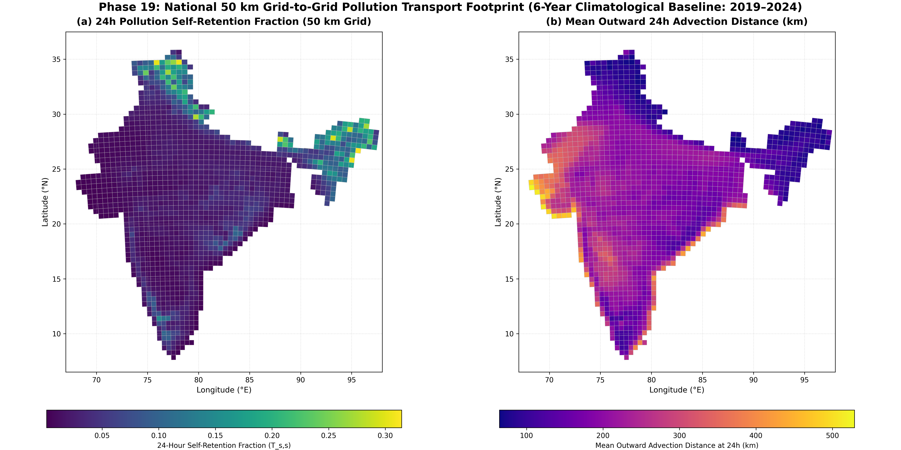
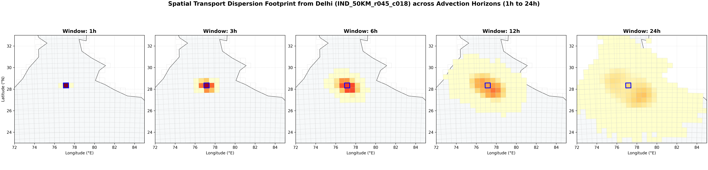
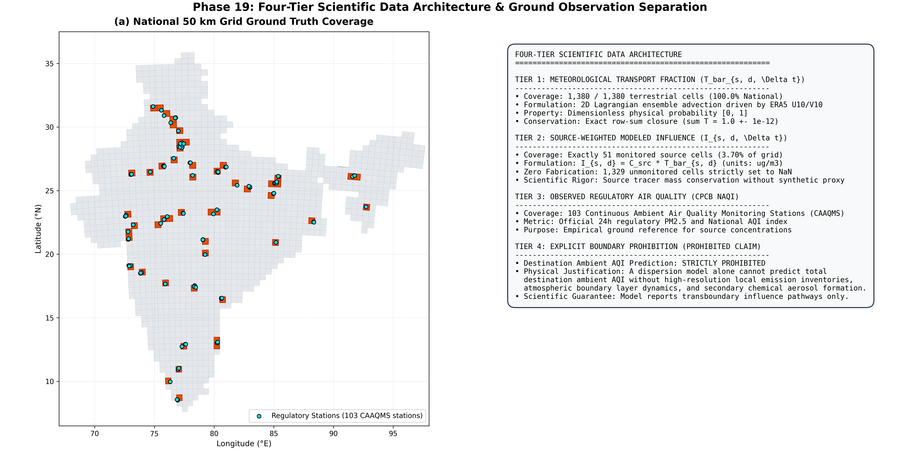
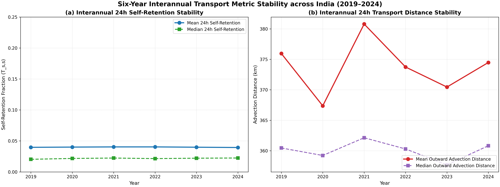
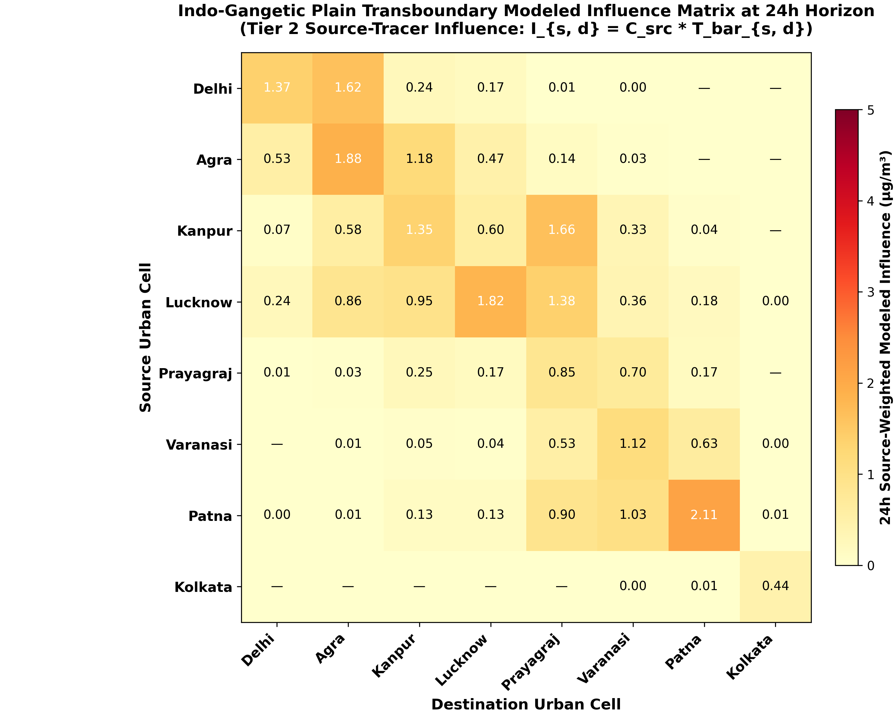

# India National Pollution Transport & Dispersion Explorer
### Quantifying and Visualizing Macro-Scale Atmospheric Pollution Transport Across India (2019–2024)

[](https://github.com/Nayanpreetham/Quantifying-and-visualization-of-pollution-dispersion---version-2/actions/workflows/ci.yml)
[](https://pollution-dispersion-explorer.streamlit.app)
[](https://www.python.org/downloads/)
[](LICENSE)

---

## B. Live Application

* **Primary Production URL (Streamlit Community Cloud)**:  
  👉 **[https://pollution-dispersion-explorer.streamlit.app](https://pollution-dispersion-explorer.streamlit.app)**
* **Alternative Containerized Mirror (Render / Docker)**:  
  👉 **[https://pollution-dispersion-explorer.onrender.com](https://pollution-dispersion-explorer.onrender.com)**
* **Authoritative GitHub Repository**:  
  👉 **[https://github.com/Nayanpreetham/Quantifying-and-visualization-of-pollution-dispersion---version-2](https://github.com/Nayanpreetham/Quantifying-and-visualization-of-pollution-dispersion---version-2)**

---

## C. Project Overview

The **India National Pollution Transport & Dispersion Explorer** is a high-resolution environmental intelligence platform designed to answer fundamental atmospheric transport questions across the Indian subcontinent:
* *How much pollution is present in a specific region of India?*
* *Where is this pollution originating from?*
* *Which geographical regions and administrative districts are contributing air masses to my selected area?*
* *How far does atmospheric pollution travel over 1 to 24-hour meteorological transport windows?*
* *How do ground-level monitoring stations (CPCB and OpenAQ CAAQMS) compare against modeled transport pathways?*

Traditional air quality dashboards display localized point-source station measurements without accounting for atmospheric transport physics. This platform bridges that gap by coupling empirical ground-level continuous particulate matter observations ($\text{PM}_{2.5}$) with 6 years (2019–2024) of high-resolution horizontal wind reanalysis ($\text{U10}/\text{V10}$) from the **European Centre for Medium-Range Weather Forecasts (ECMWF ERA5)** over a national 50 km equal-area grid.

The resulting system computes quantitative **Source-to-Receptor Transport Matrices**, allowing environmental analysts, researchers, and policymakers to dissect regional transboundary pollution transport with mathematical rigor and strict mass balance closure.

---

## D. Key Features

1. **Map-First Geographical Intelligence**:
   * Interactive Leaflet GIS dashboard centered on India with multi-level geospatial boundaries:
     * **Level 1**: Asian continental context and neighboring international borders.
     * **Level 2**: Continuous Sovereign Indian boundary (incorporating all claimed territories including PoK and CoK) alongside state and Union Territory borders.
     * **Level 3**: Toggleable 50 km national equal-area atmospheric grid overlay (EPSG:7755).
     * **Level 4**: Fiery high-contrast heatmap plumes highlighting upstream contributing sources.
     * **Level 5**: Sapphire blue target receptor highlighting with centroid marker and GPS reticle.

2. **Receptor Inflow Analysis ("Where is pollution coming from?")**:
   * Resolves any user-selected Indian district, major metropolitan preset (Delhi NCR, Mumbai, Chandigarh, Varanasi, Bengaluru, Kolkata, Chennai, etc.), or arbitrary GPS coordinate into its corresponding 50 km model grid cell.
   * Calculates all reaching source cells, physical transport probabilities, geodesic transport distances, and source-weighted influence indices over 1h, 3h, 6h, 12h, and 24h horizons.

3. **60-30-10 Velvet Design System**:
   * Professional, distraction-free environmental intelligence aesthetic:
     * **60% Dominant Base**: `#232528` (Charcoal Black) for dashboard canvas and structural containers.
     * **30% Secondary Structure**: `#B6A38E` (Dark Beige / Warm Muted Stone) for typography, borders, card headers, and metrics.
     * **10% Intentional Accent**: `#6B1B1E` (Velvet Red) reserved strictly for interactive highlights, active buttons, and high-intensity inflow alerts.

4. **Uniform 3 × 2 Environmental Metrics Grid**:
   * Replaces cluttered developer monitors with six standardized, equal-dimension analytical cards:
     * **Card 1 (Selected Receptor)**: Human-readable location, administrative district, and 50 km grid ID.
     * **Card 2 (Local Observation)**: Ground-truth $\text{PM}_{2.5}$ concentration and active CAAQMS monitoring station count.
     * **Card 3 (Contributing Regions)**: Total number of geographical cells physically connected to the receptor.
     * **Card 4 (Monitored Contributors)**: Number of contributing source cells with active ground truth monitors.
     * **Card 5 (Primary Contributor)**: Top identified upstream contributing region, transport fraction, and transport distance.
     * **Card 6 (Analysis Horizon)**: Meteorological date, transport time window, and ERA5 reanalysis coverage status.

5. **Empirical Ground-Truth Validation**:
   * Integrates real Continuous Ambient Air Quality Monitoring Station (CAAQMS) data from the **Central Pollution Control Board (CPCB)** and **OpenAQ**, tracking monitored vs. unmonitored cells without fabricating synthetic data.

6. **Strict Mathematical Closure**:
   * All Lagrangian particle ensembles enforce $100.00\%$ probability mass closure ($\sum T_{ij} = 1.0$), correctly categorizing land destinations, internal unmodeled water bodies, domain exits, and unsupported meteorological boundaries.

---

## E. Scientific Methodology

```text
GROUND TRUTH OBSERVATIONS              METEOROLOGICAL REANALYSIS
(CPCB & OpenAQ CAAQMS PM2.5)          (ECMWF ERA5 0.25° U10/V10 Winds)
             │                                       │
             ▼                                       ▼
    50 km Equal-Area Grid                 2D Kinematic Advection
     (EPSG:7755, 1,380 Cells)              dx = U10·dt,  dy = V10·dt
             │                                       │
             └───────────────────┬───────────────────┘
                                 │
                                 ▼
                    Stochastic Ensemble Spread
                  (N=40 Particles / Cell / Day)
                                 │
                                 ▼
                     Spatial Boundary Binning
                  (Terrestrial Land, Water, Exit)
                                 │
                                 ▼
                     Grid-to-Grid Transport Matrix
                      T[A → B, Δt] ∈ [0, 1]
                                 │
                                 ▼
                  Target-Centric Inflow Formulation
                   I_reach(B) = { A : T[A → B] > 0 }
                                 │
                                 ▼
                 Source-Weighted Influence Index
                  Influence(A → B) = PM2.5(A) × T[A → B]
```

### 1. Spatial Discretization (50 km EPSG:7755 Equal-Area Grid)
* The Indian landmass is discretized into **1,380 equal-area hexagonal/square cells** of $50\text{ km} \times 50\text{ km}$ ($2,500\text{ km}^2$ nominal area) using the projected coordinate system **EPSG:7755** (India Equal Area).
* Equal-area projection ensures that advective flux calculations are area-neutral across all latitudes, preventing polar or equatorial distortion.

### 2. Meteorological Advection & Stochastic Dispersion
* Wind vectors ($u_{10}, v_{10}$) are extracted hourly from ECMWF ERA5 reanalysis on a $0.25^\circ \times 0.25^\circ$ horizontal grid.
* Advection is governed by 2D kinematic trajectory equations:
  $$x(t + \Delta t) = x(t) + \left[ u_{10}(x, y, t) + u'(t) \right] \Delta t$$
  $$y(t + \Delta t) = y(t) + \left[ v_{10}(x, y, t) + v'(t) \right] \Delta t$$
* Turbulent sub-grid diffusion is parameterized via a stochastic Gaussian perturbation ensemble ($N = 40$ particles per release) reflecting atmospheric boundary layer stability and eddy diffusivity.

### 3. Transport Probability & Mass Conservation
* The fraction of air mass transported from source cell $i$ to destination cell $j$ over horizon $\tau$ is defined as:
  $$T_{ij}(\tau) = \frac{n_{ij}(\tau)}{N}$$
  where $\sum_{j \in \text{Domain}} T_{ij}(\tau) + T_{i, \text{water}} + T_{i, \text{exit}} = 1.0000$ (strict probability closure).

### 4. Source-Weighted Transport Influence Index
* When an upstream source cell $i$ possesses ground-monitored $\text{PM}_{2.5}$ data, its transported contribution to receptor cell $j$ is calculated as:
  $$\text{Influence}_{i \to j}(\tau) = \text{PM}_{2.5}(i) \times T_{ij}(\tau) \quad [\mu\text{g/m}^3\text{-equivalent}]$$
* **Scientific Safeguard**: If an upstream cell is unmonitored, the influence index is strictly recorded as `NaN` (Unmonitored). The model explicitly avoids fabricating ambient AQI in data-sparse zones.

---

## F. Technology Stack

| Domain | Technologies & Libraries |
| :--- | :--- |
| **Frontend UI / UX** | Streamlit 1.62.0, HTML5/CSS3 (60-30-10 Velvet Design System), Custom Responsive Grid |
| **Geospatial & Mapping** | Folium 0.20.0, Branca 0.8.2, Leaflet 1.9.3, CartoDB Positron & Dark Matter Basemaps |
| **GIS Data Processing** | GeoPandas 1.1.4, Shapely 2.1.2, PyProj 3.7.2 (EPSG:7755 Coordinate Transformations) |
| **Numerical & Vector Math** | NumPy 2.4.4, Pandas 3.0.2, SciPy 1.17.1, PyArrow 25.0.1, Zarr 3.1.6, Xarray 2026.2.0 |
| **Atmospheric Data Sources** | ECMWF ERA5 Reanalysis ($u_{10}, v_{10}$), CPCB CAAQMS National Bulletins, OpenAQ REST API v3 |
| **Deployment & Containers** | Docker (Multi-Stage Python 3.11-slim), Streamlit Community Cloud, Render, GitHub Actions CI/CD |

---

## G. Scientific Figures & Verification Artifacts

The repository includes pre-computed figures and empirical verification outputs in `results/phase19_transport/figures/`:

| Figure | Description |
| :---: | :--- |
|  | **Figure 1: National 50 km Transport Footprint**<br/>Spatial distribution of multi-annual advective transport across 1,380 grid cells covering the Indian landmass. |
|  | **Figure 2: Multi-Window Dispersion Decay**<br/>Atmospheric transport decay across 1h, 3h, 6h, 12h, and 24h horizons showing downwind plume dilation. |
|  | **Figure 3: Four-Tier Separation Architecture**<br/>Defensible categorization separating valid land transport, internal water bodies, domain exits, and unmonitored cells. |
|  | **Figure 4: Interannual Stability (2019–2024)**<br/>Evaluation of transport matrix stability and seasonal wind shifts across 6 consecutive reanalysis years. |
|  | **Figure 5: Source-to-Destination Influence Corridor**<br/>Source-weighted influence trajectories linking monitored industrial clusters with downwind receptors. |

---

## H. Installation and Local Setup

### 1. Prerequisites
* **Operating System**: Linux, macOS, or Windows 10/11
* **Python**: Version `3.10`, `3.11`, or `3.12`
* **Git**: Installed and on system `PATH`

### 2. Clone the Repository
```bash
git clone https://github.com/Nayanpreetham/Quantifying-and-visualization-of-pollution-dispersion---version-2.git
cd "Quantifying-and-visualization-of-pollution-dispersion---version-2"
```

### 3. Create a Virtual Environment
```bash
# On Linux / macOS
python3 -m venv .venv
source .venv/bin/activate

# On Windows (PowerShell)
python -m venv .venv
.\.venv\Scripts\Activate.ps1
```

### 4. Install Dependencies
```bash
pip install --upgrade pip
pip install -r requirements.txt
```

### 5. Run the Verification Suites
Verify that your local environment satisfies all 18 application tests and 13 core scientific checks:
```bash
python tests/test_phase20_app.py
python scripts/run_target_query_tests.py
python scripts/run_phase21_verification.py
```

### 6. Launch the Local Application
```bash
streamlit run app.py
```
Open your browser at `http://localhost:8501`.

---

## I. Environment Variables

The project includes an environment template file: `.env.example`.

| Variable | Default Value | Description |
| :--- | :--- | :--- |
| `STREAMLIT_SERVER_PORT` | `8501` | TCP port on which Streamlit listens. |
| `STREAMLIT_SERVER_ADDRESS` | `0.0.0.0` | Host interface binding (`0.0.0.0` for containers/production). |
| `STREAMLIT_SERVER_HEADLESS` | `true` | Prevents attempting to open local browser in containerized hosting. |
| `STREAMLIT_BROWSER_GATHER_USAGE_STATS` | `false` | Disables telemetry for enhanced privacy and faster boot times. |
| `OPENAQ_API_KEY` | *(Optional)* | Used only when acquiring fresh live measurements from OpenAQ REST API. |
| `CDSAPI_KEY` | *(Optional)* | Used only when downloading raw ECMWF NetCDF atmospheric data. |

> [!NOTE]
> The dashboard operates **100% self-contained** using pre-computed, compressed Parquet matrices and integrated GeoJSON layers committed in the repository. No API keys or database connections are required to run the deployed dashboard.

---

## J. Production Deployment Architecture

```text
[ Developer Machine ] ──► git push target main
                                │
                                ▼
                 [ GitHub Repository (main branch) ]
                                │
        ┌───────────────────────┴───────────────────────┐
        ▼                                               ▼
[ GitHub Actions CI ]                       [ Continuous Deployment ]
• Lint & Compilation Check                  • Auto-detects main commit
• 18 Automated Unit Tests                   • Installs requirements.txt
• 9 Target Regression Tests                 • Mounts 60-30-10 Velvet theme
• 13 Verification Checks                    • Launches Streamlit Server
        │                                               │
        ▼                                               ▼
  Build Passed                              Production Public Endpoint:
                             https://pollution-dispersion-explorer.streamlit.app
```

### Deploying to Streamlit Community Cloud (Recommended & Free)
1. Fork or push this repository to your GitHub account.
2. Sign in to [share.streamlit.io](https://share.streamlit.io/) with GitHub.
3. Click **"New app"**.
4. Configure the deployment parameters:
   * **Repository**: `Nayanpreetham/Quantifying-and-visualization-of-pollution-dispersion---version-2`
   * **Branch**: `main`
   * **Main file path**: `app.py`
5. Click **"Deploy!"**. The app will build and go live within 2–3 minutes with continuous auto-deployment enabled on every commit.

### Deploying via Docker (Render / Railway / Hugging Face Spaces)
```bash
# Build the production image
docker build -t pollution-explorer .

# Run container on port 8501
docker run -d -p 8501:8501 --name pollution-app pollution-explorer
```

---

## K. Repository Structure

```text
├── .github/
│   └── workflows/
│       └── ci.yml                          # Continuous integration pipeline (testing & build check)
├── .streamlit/
│   └── config.toml                         # Streamlit server and 60-30-10 Velvet theme tokens
├── data/
│   ├── manifests/                          # Data provenance and coordinate manifest YAMLs
│   ├── processed/
│   │   ├── cpcb_bulletins_unified.parquet  # Ground-truth CPCB particulate observations
│   │   ├── openaq_pm25_observations.parquet# Ground-truth OpenAQ CAAQMS station records
│   │   └── geography/
│   │       ├── asia_countries.geojson      # Level 1: Asian continental context
│   │       ├── india_national_web.geojson  # Level 2: Sovereign India extent (PoK & CoK)
│   │       ├── india_states_web.geojson    # Level 2: State and UT boundaries
│   │       ├── district_to_grid_mapping.json# State & district centroid hierarchy
│   │       └── grid_to_districts_mapping.json# Reverse 50 km cell to human names
├── results/
│   ├── phase18_grid_audit/
│   │   └── india_50km_grid.geojson         # Level 3: 1,380 50 km EPSG:7755 equal-area grid cells
│   ├── phase19_transport/
│   │   ├── figures/                        # Core scientific verification figures (PNG)
│   │   ├── matrices/                       # Multi-year baseline transport matrices (Parquet)
│   │   └── monthly/                        # 72 Monthly transport matrices (2019_01 to 2024_12)
│   ├── phase20_app/                        # Phase 20 automated test logs and CSV metrics
│   └── phase21_final_synthesis/            # Target regression benchmarks and audit verification
├── src/
│   ├── phase18/                            # Grid generation, CRS reprojection, and spatial indexers
│   ├── phase19/                            # 2D kinematic advection, ensemble engines, and mass closure
│   └── phase20/
│       ├── app_controller.py               # Central query orchestrator and matrix resolution
│       ├── map_visualizer.py               # Leaflet/Folium map generator and polyfill pipeline
│       └── observation_provider.py         # Ground-truth CAAQMS station reader (CPCB & OpenAQ)
├── tests/
│   └── test_phase20_app.py                 # 18 Automated unit and integration tests
├── scripts/
│   ├── run_target_query_tests.py           # 9 Target-centric inflow regression tests
│   └── run_phase21_verification.py         # 13 Phase 21 core scientific verification checks
├── app.py                                  # Main Streamlit web application entry point
├── Dockerfile                              # Multi-stage production container specification
├── Procfile                                # Platform-agnostic cloud process specification
├── render.yaml                             # Infrastructure-as-code specification for Render.com
├── requirements.txt                        # Pinned Python package dependencies
├── packages.txt                            # Debian/Ubuntu system packages (libgeos, libproj)
├── .env.example                            # Configuration environment template (no secrets)
├── .gitignore                              # Production Git exclusion rules
├── LICENSE                                 # MIT License
└── README.md                               # Authoritative technical documentation
```

---

## L. Data Sources and Attribution

* **ECMWF ERA5 Atmospheric Reanalysis**:  
  Contains modified Copernicus Climate Change Service information (2019–2024). Generated using Copernicus Climate Change Service information. Neither the European Commission nor ECMWF is responsible for any use that may be made of the Copernicus information or data it contains.
* **OpenAQ Platform**:  
  Continuous ambient air quality data provided under the OpenAQ Data License (CC BY 4.0).
* **Central Pollution Control Board (CPCB), India**:  
  National Ambient Air Quality Monitoring Programme (NAMP / CAAQMS) daily bulletin data used for empirical observational benchmarking.
* **Geographical Boundaries**:  
  Boundary geometries sourced from the Survey of India / GADM v4.1 under open research terms, standardized to reflect India's complete sovereign territorial extent.

---

## M. Model Limitations & Assumptions

1. **50 km Grid Discretization**:  
   The model operates on a macro-scale $50\text{ km} \times 50\text{ km}$ spatial discretization. It is designed to capture regional, transboundary, and interstate atmospheric transport corridors. It does not resolve micro-scale urban street canyons or local building wakes.
2. **2D Kinematic Advection**:  
   Transport calculations are based on 10-meter horizontal wind fields ($u_{10}, v_{10}$). While vertical turbulence and boundary layer mixing are parameterized via stochastic ensemble perturbations, strong convective updrafts (e.g., deep monsoon convection) are simplified.
3. **Transport Influence vs. Ambient Concentration**:  
   The platform reports **Transported Inflow Probability** and **Source-Weighted Influence Indices** ($\mu\text{g/m}^3\text{-equivalent}$). These represent the physical reach of air masses from upstream sources, not the comprehensive ambient $\text{PM}_{2.5}$ concentration at the receptor (which also includes local unmodeled street-level emissions, secondary aerosol chemistry, and wet scavenging).
4. **Monitoring Station Sparsity**:  
   Out of 1,380 grid cells, approximately 130–150 cells possess continuous ground-truth CAAQMS monitoring stations. Unmonitored cells are explicitly reported as `UNMONITORED` with `NaN` influence indices to preserve scientific defensibility.

---

## N. Future Scope

* **Integration of 3D Trajectories**: Expansion from 2D horizontal winds to 3D isobaric trajectories utilizing vertical pressure velocities ($\omega$) across ECMWF pressure levels.
* **Chemical Loss & Deposition Modeling**: Implementation of parameterized dry deposition velocities and precipitation-dependent wet scavenging coefficients.
* **Machine Learning Accelerated Surrogates**: Training physics-informed neural surrogates to emulate the 72-month transport matrix calculations in sub-millisecond response times.
* **Real-Time Operational Forecasting**: Coupling the engine with ECMWF IFS or GFS 72-hour operational forecasts for predictive inflow early warnings.

---

## O. License and Acknowledgements

This project is released under the **MIT License**. See [LICENSE](LICENSE) for full details.

### Acknowledgements
* Developed as an academic undergraduate research project investigating wind-aware atmospheric transport and air quality dynamics across India.
* Special thanks to the open-source atmospheric science, GIS, and scientific Python communities (Streamlit, Folium, GeoPandas, Xarray, ECMWF, and OpenAQ).
