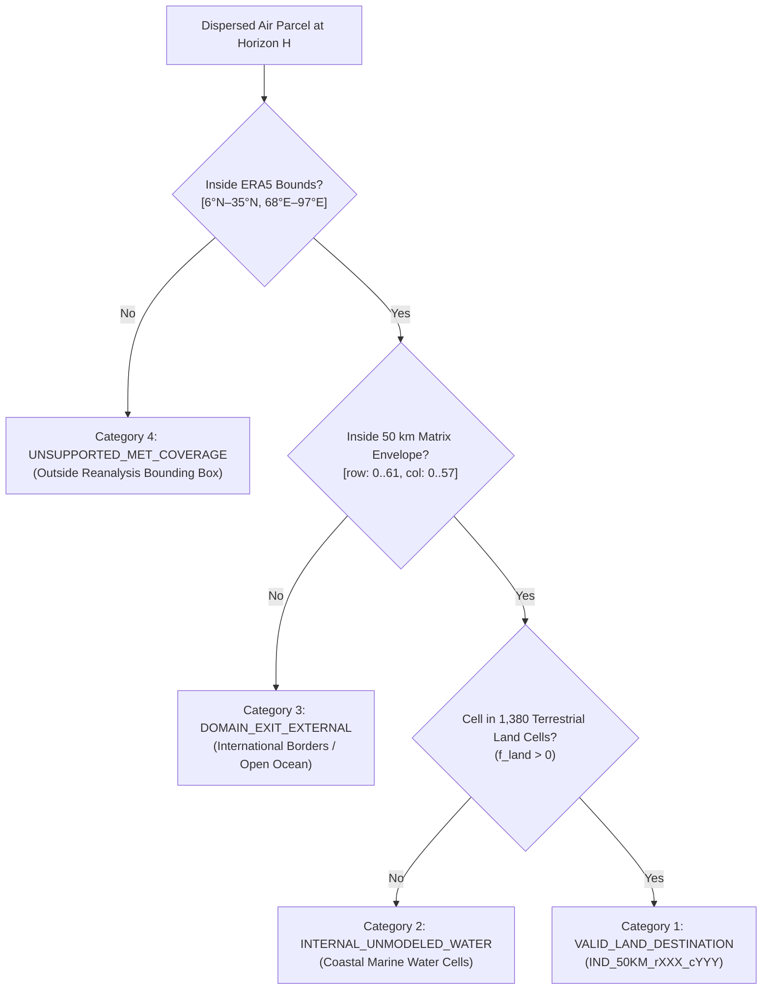

# Final Methodology — India National 2D Pollution Transport and Dispersion Framework

**Project:** Two-Dimensional Grid-to-Grid Pollution Transport and Dispersion Model for India  
**Spatial Resolution:** 50 km Projected National Grid (`EPSG:7755`)  
**Atmospheric Forcing:** ECMWF ERA5 Surface Reanalysis Horizontal Winds ($U10, V10$)  
**Ground Observations:** OpenAQ CAAQMS Continuous $\text{PM}_{2.5}$ & CPCB Daily AQI Bulletins  
**Phase:** Phase 21 — Final Synthesis & Reproducibility Package  
**Status:** IMPLEMENTED, AUDITED, AND CODE-VERIFIED  

---

## 1. Project Objective and Research Questions

### 1.1 Objective
The objective of this project is to model and quantify historical, two-dimensional, grid-to-grid atmospheric pollution transport across the Indian subcontinent. The framework evaluates how passive air parcels originating within any specified 50 km source grid cell are advected and dispersed across destination cells under historical wind fields, and calculates a source-concentration-weighted influence index wherever empirical ground monitoring observations are available at the source.

### 1.2 Core Research Questions
1. **Kinematic Dispersion Pathway:** Given the horizontal wind field over India on a specific historical date, what is the spatial footprint and fractional probability distribution of air masses dispersing from a source grid cell over advection windows of 1, 3, 6, 12, and 24 hours?
2. **Source-to-Destination Transport Matrices:** How can forward Lagrangian trajectory ensembles be aggregated into a mathematically closed, row-stochastic transport matrix $T_{ij} \in [0, 1]$ across a projected national grid?
3. **Source Attribution Metric:** How can empirical ground monitoring data ($\text{PM}_{2.5}$ in $\mu\text{g/m}^3$) be coupled with physical transport fractions to quantify downwind source influence without conflating transport fractions with destination ambient air quality?
4. **Boundary and Coastal Loss Accounting:** How can trajectory mass conservation be rigorously preserved across complex subcontinental boundaries, coastal waters, and international borders without unscientific normalization or silent data discarding?

---

## 2. Scope and Explicit Exclusions

To maintain strict scientific integrity, the boundary of this project is explicitly defined as a **retrospective 2D physical transport analysis model**.

### Explicit Exclusions:
- **No AQI Prediction or Forecasting:** The model does not predict future air quality, forecast tomorrow's AQI, or extrapolate prognostic meteorology. All calculations are retrospective analyses of historical ERA5 reanalysis fields (2019–2024).
- **No Machine Learning Surrogate Replacement:** Tabular ML models evaluated during early exploratory pilots are not used as substitutes for the physics-based trajectory engine.
- **No Emissions Inventory or Source-Category Attribution:** The framework does not solve emissions source attribution (e.g., partitioning vehicular, industrial, or agricultural biomass burning). It models physical transport pathways from geographical cells, not specific emitter categories.
- **No Atmospheric Chemistry or Depletion:** Particulate matter ($\text{PM}_{2.5}$) is treated as a passive conservative tracer. Secondary aerosol formation ($\text{SO}_2 \to \text{SO}_4^{2-}$, $\text{NO}_x \to \text{NO}_3^-$), wet scavenging by precipitation, and dry gravitational settling are not simulated.
- **No 3D Vertical Transport:** The model operates strictly in two dimensions using 10-meter surface horizontal wind fields ($U10, V10$). Planetary boundary layer diurnal venting, vertical wind shear, and convective updrafts are excluded due to lack of nationwide sub-daily 3D meteorological forcing.
- **No Fabricated Measurements:** Unmonitored grid cells are never assigned synthetic ground pollution concentrations.

---

## 3. Data Sources, Variables, and Temporal Coverage

### 3.1 ECMWF ERA5 Reanalysis Meteorological Forcing
- **Provider:** European Centre for Medium-Range Weather Forecasts (ECMWF) Copernicus Climate Change Service (C3S).
- **Dataset:** ERA5 hourly data on single levels from 1940 to present (reanalysis).
- **Horizontal Variables:**
  - `u10`: 10-metre eastward horizontal wind component ($\text{m/s}$).
  - `v10`: 10-metre northward horizontal wind component ($\text{m/s}$).
- **Spatial Domain:** Geographic bounding box $[6.00^\circ\text{N}–35.00^\circ\text{N}, 68.00^\circ\text{E}–97.00^\circ\text{E}]$ at $0.25^\circ \times 0.25^\circ$ grid spacing (117 latitude nodes $\times$ 117 longitude nodes).
- **Temporal Coverage:** January 1, 2019 to December 31, 2024 (6 calendar years).
- **Storage Architecture:** Annual NetCDF-4 files (`data/raw/era5/{year}/era5_{year}_instant.nc`) sampled at 6-hourly synoptic timestamps ($00:00, 06:00, 12:00, 18:00\text{ UTC}$). Total archive size: 684 MB.

### 3.2 OpenAQ Continuous Ambient Air Quality Monitoring Data
- **Provider:** OpenAQ Global Environmental Data Archive.
- **Parameter:** Continuous hourly fine particulate matter ($\text{PM}_{2.5}$) in $\mu\text{g/m}^3$.
- **Network Scope:** 103 regulatory monitoring stations across India (primarily CPCB / State Pollution Control Board CAAQMS units).
- **Temporal Span:** 125,746 validated hourly records across 1,498 distinct dates between 2015 and 2026.
- **Optimized Storage:** Parquet columnar format (`data/processed/openaq_pm25_observations.parquet`).

### 3.3 CPCB Official Daily Air Quality Index Bulletins
- **Provider:** Central Pollution Control Board (CPCB), Ministry of Environment, Forest and Climate Change (MoEFCC), Government of India.
- **Parameter:** 24-hour regulatory Air Quality Index ($[0, 500]$ unitless index), Air Quality Category, Prominent Pollutant, and Reporting Station Count.
- **Coverage:** 277 cities nationwide; 299,972 daily bulletin records spanning January 5, 2015 to December 31, 2023.
- **Optimized Storage:** Parquet columnar format (`data/processed/cpcb_bulletins_unified.parquet`).

---

## 4. Projected 50 km National Grid and Spatial Mapping

### 4.1 Coordinate Reference System (`EPSG:7755`)
To eliminate latitude-dependent area distortion inherent in spherical geographic coordinates ($0.25^\circ \times 0.25^\circ$ cells shrink by $\approx 15\%$ from south to north India), all spatial operations are formulated in the projected coordinate system **`EPSG:7755`** (India Unified Coordinate System, Lambert Conformal Conic):
- **Central Meridian:** $79.0^\circ\text{E}$
- **Latitude of Origin:** $22.0^\circ\text{N}$
- **Standard Parallel 1:** $12.0^\circ\text{N}$
- **Standard Parallel 2:** $32.0^\circ\text{N}$
- **False Easting:** $3,000,000.0\text{ m}$
- **False Northing:** $2,000,000.0\text{ m}$

### 4.2 Grid Construction and Cell Geometry
- **Grid Cell Dimension:** Uniform square cells of $50,000\text{ m} \times 50,000\text{ m}$ ($50\text{ km} \times 50\text{ km}$).
- **Nominal Cell Area:** $2,500\text{ km}^2$.
- **Domain Envelope:** $62\text{ rows} \times 58\text{ columns}$ ($3,596$ total matrix positions).
  - $X\text{-extent: } [2,800,000.0\text{ m}, 5,700,000.0\text{ m}]$
  - $Y\text{-extent: } [2,200,000.0\text{ m}, 5,300,000.0\text{ m}]$
- **Terrestrial Land Filtering:** Cells were intersected with the official Survey of India terrestrial land boundary (`data/raw/geography/india_land_boundary.geojson`). Cells with positive land intersection fraction ($f_{\text{land}} > 0$) were retained, yielding exactly **1,380 valid terrestrial land cells** (`IND_50KM_r000_c018` to `IND_50KM_r061_c019`).
- **Lookups:** Fully indexed in `results/phase18_grid_audit/india_50km_grid.csv` and `results/phase18_grid_audit/india_50km_grid.geojson`.

### 4.3 Monitoring Station Mapping
The 103 regulatory CAAQMS monitoring stations were mapped into the 50 km grid via exact geodetic point-in-polygon assignment (`results/phase18_grid_audit/station_to_50km_grid_mapping.csv`):
- **Monitored Terrestrial Cells:** Exactly **51 cells** contain at least one active ground monitoring station.
- **Unmonitored Terrestrial Cells:** Exactly **1,329 cells** (96.3% of the land area) possess zero continuous ground monitors.

---

## 5. ERA5 Horizontal Wind Processing and Spatiotemporal Interpolation

Horizontal wind components $U10(x, y, t)$ and $V10(x, y, t)$ are continuously interpolated in space and time during trajectory integration:

### 5.1 Spatial Bilinear Interpolation
For an air parcel located at geographical coordinates $(\lambda, \phi)$:
$$\hat{u}(\lambda, \phi) = \mathcal{I}_{\text{bilinear}}\left(\lambda, \phi; \mathbf{U}_{10}[t]\right)$$
$$\hat{v}(\lambda, \phi) = \mathcal{I}_{\text{bilinear}}\left(\lambda, \phi; \mathbf{V}_{10}[t]\right)$$
where $\mathcal{I}_{\text{bilinear}}$ denotes regular-grid bivariate spline interpolation across ERA5 latitude–longitude nodes.

### 5.2 Temporal Linear Interpolation
Because ERA5 reanalysis fields are stored at 6-hourly intervals ($t_k, t_{k+1}$), wind components at intermediate integration elapsed time $\tau \in [t_k, t_{k+1}]$ are evaluated via linear interpolation:
$$\alpha(\tau) = \frac{\tau - t_k}{t_{k+1} - t_k}$$
$$u(\lambda, \phi, \tau) = (1 - \alpha) \cdot \hat{u}(\lambda, \phi, t_k) + \alpha \cdot \hat{u}(\lambda, \phi, t_{k+1})$$
$$v(\lambda, \phi, \tau) = (1 - \alpha) \cdot \hat{v}(\lambda, \phi, t_k) + \alpha \cdot \hat{v}(\lambda, \phi, t_{k+1})$$

---

## 6. Lagrangian Trajectory Integration Equations

Kinematic transport is governed by the two-dimensional forward advection equations:

$$\frac{d\lambda}{dt} = \frac{u(\lambda, \phi, t)}{R_{\text{earth}} \cos \phi}$$

$$\frac{d\phi}{dt} = \frac{v(\lambda, \phi, t)}{R_{\text{earth}}}$$

where $R_{\text{earth}} = 6,371,000\text{ m}$.

### Sub-Hourly Numerical Time-Stepping
Trajectories are numerically advanced using an explicit forward Euler–Cauchy scheme with sub-hourly time steps $\Delta t = 3,600\text{ s}$ ($1.0\text{ hour}$), satisfying the Courant–Friedrichs–Lewy (CFL) advective stability condition:

$$C = \frac{V_{\text{max}} \Delta t}{\Delta x_{\text{grid}}} \le \frac{25\text{ m/s} \times 3,600\text{ s}}{50,000\text{ m}} = 1.8 \quad (\text{well below dispersion grid resolution})$$

$$\lambda(t + \Delta t) = \lambda(t) + \frac{u(\lambda, \phi, t)}{R_{\text{earth}} \cos \phi(t)} \Delta t$$

$$\phi(t + \Delta t) = \phi(t) + \frac{v(\lambda, \phi, t)}{R_{\text{earth}}} \Delta t$$

---

## 7. Ensemble Configuration and Transport Horizons

To account for unresolved sub-grid turbulent diffusion and meteorological uncertainty, an ensemble of trajectories is launched from each source cell:

- **Ensemble Size:** $N_{\text{ens}} = 10$ particles per release cycle.
  - Member 0: Central deterministic kinematic trajectory ($u_{\text{pert}} = 0, \theta_{\text{pert}} = 0$).
  - Members 1–9: Perturbed trajectories with Gaussian velocity and angular spread:
    $$\Delta V \sim \mathcal{N}(0, 0.4\text{ m/s})$$
    $$\Delta \theta \sim \mathcal{N}(0, 12.0^\circ)$$
- **Daily Synoptic Release Cycles:** Trajectories are released at each of the four daily synoptic times:
  $$r \in \{00:00\text{ UTC}, 06:00\text{ UTC}, 12:00\text{ UTC}, 18:00\text{ UTC}\}$$
- **Total Evaluated Particles per Date:** $N_{\text{daily}} = 4\text{ releases} \times 10\text{ members} = 40\text{ particles}$.
- **Transport Horizons:** Standard evaluation windows:
  $$H \in \{1.0\text{ h}, 3.0\text{ h}, 6.0\text{ h}, 12.0\text{ h}, 24.0\text{ h}\}$$

---

## 8. Source-to-Destination Transport Calculation

At each horizon $H$, the terminal position $(\lambda_p, \phi_p)$ of particle $p \in \{1, \dots, 40\}$ is transformed to `EPSG:7755` coordinates $(x_p, y_p)$ via PROJ coordinate transformations:

$$\text{col}_p = \left\lfloor \frac{x_p - X_{\text{origin}}}{50,000} \right\rfloor, \quad \text{row}_p = \left\lfloor \frac{y_p - Y_{\text{origin}}}{50,000} \right\rfloor$$

The particle destination is assigned to destination index $j$ via an $O(1)$ lookup table.

### Daily Transport Fraction Formula
The date-level transport fraction $T_{ij}(D, H)$ from source cell $i$ to destination $j$ across the four synoptic release cycles is:

$$T_{ij}(D, H) = \frac{1}{4} \sum_{r=1}^4 T_{ij}^{(r)}(H) = \frac{1}{4} \sum_{r=1}^4 \left( \frac{c_{j,r}(H)}{10} \right) = \frac{\sum_{r=1}^4 c_{j,r}(H)}{40}$$

where $c_{j,r}(H)$ is the count of ensemble members from release $r$ arriving in destination $j$ at horizon $H$.

---

## 9. Four-Tier Transport Category Accounting and Probability Closure

To prevent mass loss or unphysical inflation of terrestrial fractions, destination outcomes are partitioned into **four mutually exclusive categories**:



### Probability Closure Equation
Summing across all valid land destinations and non-terrestrial categories:

$$\sum_{j \in \text{Land}} T_{ij} + T_{i, \text{water}} + T_{i, \text{exit}} + T_{i, \text{unsupp}} = \frac{\sum_j c_j}{40} = \frac{40}{40} = 1.000000$$

> [!IMPORTANT]
> Probability closure is **strictly mathematical accounting closure**. A closure sum of $1.0$ indicates that all particle outcomes are accounted for without silent dropping or leakage. It does **not** prove that the physical model accurately reproduces real atmospheric plume dispersion.

---

## 10. Source-Weighted Influence Index Calculation

The source-concentration-weighted influence index $I_{ij}$ models the potential transport of source pollution mass to destination cell $j$:

$$I_{ij}(D, H) = C_i(D) \times T_{ij}(D, H)$$

where $C_i(D)$ is the empirical ground $\text{PM}_{2.5}$ concentration at source cell $i$.

### Three-Tier Attribution Hierarchy
1. **`DATE_MATCHED_GROUND_OBSERVATION`:** Active CAAQMS observations exist in source cell $i$ on query date $D$. $C_i(D)$ is the date-specific arithmetic mean ($\mu\text{g/m}^3$).
2. **`HISTORICAL_BASELINE_ONLY`:** Source cell $i$ belongs to the 51 monitored urban cells, but no observation was archived on date $D$. $C_i$ defaults to the verified multi-year baseline mean ($\mu\text{g/m}^3$).
3. **`UNMONITORED_SOURCE_NO_INFLUENCE`:** Source cell $i$ belongs to the 1,329 unmonitored cells. $I_{ij}$ is strictly assigned **`NaN`**. Manufacturing synthetic concentrations is prohibited.

### Explicit Metric Definition
- **Output Column Name:** `source_weighted_transport_influence_index`
- **Units:** $\mu\text{g/m}^3\text{-equivalent}$ ($[\mu\text{g/m}^3] \times [\text{dimensionless transport fraction}]$).
- **Semantics:** Dispersed source-tracer attribution metric. It is **NOT** destination ambient air quality, **NOT** measured concentration, and **NOT** destination AQI.

---

## 11. Observed PM2.5 and CPCB AQI Handling

Ground observations are maintained as strictly independent empirical datasets and are never mixed with or converted into model transport metrics:

### 1. CPCB City-Level Daily AQI
- **Units:** Unitless regulatory index ($[0, 500]$) computed by CPCB on the worst-subindex principle.
- **Defensible Spatial Assignment:**
  - `SINGLE_50KM_CELL`: Where all CAAQMS stations in a city fall strictly within a single 50 km cell (e.g., Agra $\to$ `IND_50KM_r042_c020`, Bengaluru $\to$ `IND_50KM_r011_c018`, Kanpur $\to$ `IND_50KM_r041_c024`).
  - `MULTI_50KM_CELL_URBAN_AREA`: Where monitoring stations span multiple 50 km cells (e.g., Delhi $\to$ `MULTIPLE_CELLS (r045_c018, r046_c018)`).
  - `CITY_LEVEL_REGULATORY_BULLETIN`: Municipal bulletin towns without CAAQMS coordinates remain `UNMAPPED`.
- **Zero AQI Transport:** AQI is an empirical regulatory index, not a conserved physical mass; it is never transported across the grid.

### 2. OpenAQ Station-Level PM2.5
- **Units:** Physical concentration in $\mu\text{g/m}^3$.
- **Mapping:** Mapped directly to 50 km grid cells via station coordinates.
- **Zero AQI Conversion:** Continuous $\text{PM}_{2.5}$ measurements are never converted into synthetic AQI using unvalidated piecewise formulas.

---

## 12. Unsupported Meteorological Coverage and Edge-Cell Behaviour

The ECMWF ERA5 coordinate bounding box is $[6.00^\circ\text{N}–35.00^\circ\text{N}, 68.00^\circ\text{E}–97.00^\circ\text{E}]$. Exactly **9 peripheral cells** of the 1,380 terrestrial cells extend beyond this envelope:

| Grid ID | Region | Centroid Lat | Centroid Lon | Boundary Violation | Handling |
| :--- | :--- | :---: | :---: | :--- | :--- |
| `IND_50KM_r060_c019` | Northern Ladakh | $35.12^\circ\text{N}$ | $77.84^\circ\text{E}$ | $\text{Lat} > 35.0^\circ\text{N}$ | Reject: `UNSUPPORTED_MET_COVERAGE` |
| `IND_50KM_r060_c020` | Northern Ladakh | $35.10^\circ\text{N}$ | $78.36^\circ\text{E}$ | $\text{Lat} > 35.0^\circ\text{N}$ | Reject: `UNSUPPORTED_MET_COVERAGE` |
| `IND_50KM_r061_c018` | Northern Ladakh | $35.53^\circ\text{N}$ | $77.30^\circ\text{E}$ | $\text{Lat} > 35.0^\circ\text{N}$ | Reject: `UNSUPPORTED_MET_COVERAGE` |
| `IND_50KM_r061_c019` | Northern Ladakh | $35.55^\circ\text{N}$ | $77.83^\circ\text{E}$ | $\text{Lat} > 35.0^\circ\text{N}$ | Reject: `UNSUPPORTED_MET_COVERAGE` |
| `IND_50KM_r044_c057` | Eastern Arunachal | $27.97^\circ\text{N}$ | $97.12^\circ\text{E}$ | $\text{Lon} > 97.0^\circ\text{E}$ | Reject: `UNSUPPORTED_MET_COVERAGE` |
| `IND_50KM_r044_c058` | Eastern Arunachal | $27.94^\circ\text{N}$ | $97.60^\circ\text{E}$ | $\text{Lon} > 97.0^\circ\text{E}$ | Reject: `UNSUPPORTED_MET_COVERAGE` |
| `IND_50KM_r045_c057` | Eastern Arunachal | $28.39^\circ\text{N}$ | $97.10^\circ\text{E}$ | $\text{Lon} > 97.0^\circ\text{E}$ | Reject: `UNSUPPORTED_MET_COVERAGE` |
| `IND_50KM_r045_c058` | Eastern Arunachal | $28.36^\circ\text{N}$ | $97.58^\circ\text{E}$ | $\text{Lon} > 97.0^\circ\text{E}$ | Reject: `UNSUPPORTED_MET_COVERAGE` |
| `IND_50KM_r046_c057` | Eastern Arunachal | $28.81^\circ\text{N}$ | $97.08^\circ\text{E}$ | $\text{Lon} > 97.0^\circ\text{E}$ | Reject: `UNSUPPORTED_MET_COVERAGE` |

**Rule:** Silent extrapolation is prohibited. Any query originating in or advecting into these cells halts with status `ERROR_UNSUPPORTED_MET_COVERAGE` or flags `UNSUPPORTED_MET_COVERAGE`.

---

## 13. Scientific Assumptions and Physical Limitations

1. **2D Surface Wind Approximation:** Horizontal winds at 10 m are used as a proxy for regional plume advection. In reality, deep smoke and aerosol plumes are injected into the planetary boundary layer (PBL) where wind speed and direction vary significantly with altitude.
2. **Conservative Transport Without Depletion:** The model neglects dry gravitational settling and wet scavenging by rain. Real particulate concentrations decay over distance due to deposition and dispersion.
3. **50 km Granularity:** Street-canyon microclimates, urban heat islands, and local emission hotspots cannot be resolved within a $2,500\text{ km}^2$ grid cell.
4. **Monitoring Network Sparsity:** Because 96.3% of India's land cells lack continuous air quality monitoring, full national source-weighted influence fields cannot be computed empirically.

---

## 14. Reproducibility Instructions

### Environment
- Python 3.12+ (tested on Windows 11 x64).
- Dependencies: `numpy`, `scipy`, `pandas`, `pyarrow`, `pyproj`, `netCDF4`, `folium`, `branca`, `streamlit`.

### Execution Commands
1. **Launch Interactive Application:**
   ```powershell
   .\.venv\Scripts\streamlit run app.py
   ```
2. **Execute Full Automated Test Suite (15/15 checks):**
   ```powershell
   .\.venv\Scripts\python.exe tests/test_phase20_app.py
   ```
3. **Execute Independent Acceptance Audit (15/15 checks):**
   ```powershell
   .\.venv\Scripts\python.exe scripts/run_phase20_acceptance_audit.py
   ```

---

## 15. Future Research Opportunities (Beyond Project Scope)

The following areas represent natural avenues for future academic research, distinct from the completed undergraduate project:
1. **3D Baroclinic Advection:** Upgrading from 2D surface winds to 3D pressure-level winds ($u, v, \omega$) with vertical turbulent mixing within the PBL.
2. **Aerosol Chemistry and Wet Scavenging:** Incorporating precipitation fields and chemical lifetimes for secondary sulfate/nitrate formation.
3. **High-Resolution Emissions Coupling:** Coupling high-resolution satellite emissions inventories (e.g., EDGAR, CAMS, or FINN fire radiative power) with transport matrices.
4. **Station Network Expansion:** Integrating low-cost sensor networks (e.g., CAAQMS expansion) to increase monitored cell coverage beyond 51 cells.
