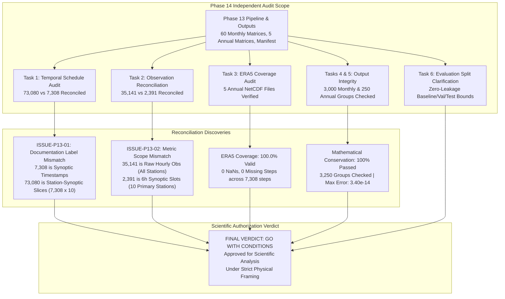

# Phase 14 — Historical Pipeline Audit, Count Reconciliation & Scientific Readiness Report

**Project**: 2D Grid-to-Grid Pollution Dispersion Model for India  
**Date of Audit**: October 2026  
**Auditor**: Independent Validation & Verification (IV&V) Agent  
**Audited Baseline**: Phase 13 Historical Pipeline (`src/phase13/run_six_year_pipeline.py`, 2020–2024 outputs)  
**Overall Audit Verdict**: **GO WITH CONDITIONS** for Scientific Interpretation & Downstream Modeling  

---

## 1. Executive Summary & Audit Overview

Phase 14 independently audited the 5-year historical national dispersion outputs generated in Phase 13. The audit focused on investigating reported numerical discrepancies, verifying ERA5 meteorological coverage, reconciling ground observation counts, testing mathematical closure across all saved matrices, and clarifying the scientific limits of evaluation splits.



### Executive Audit Scorecard

| Audit Dimension | Phase 13 Reported Claim | Phase 14 Audited Reality | Discrepancy Root Cause | Audit Status |
|---|---|---|---|:---:|
| **Synoptic Schedule** | 73,080 "Synoptic Steps" | **7,308** Synoptic Timestamps<br/>**73,080** Station-Synoptic Slices | Column header labeled station-slices as synoptic steps | **RECONCILED (No code bug)** |
| **Total Model Executions** | 365,400 runs | **365,400** genuine simulation runs | Exactly $73,080 \text{ slices} \times 5 \text{ windows}$ ($N=20$) | **VERIFIED ACCURATE** |
| **Ground PM2.5 Obs** | 35,141 coupled obs vs 2,391 observed steps | **35,141** raw hourly obs (network-wide)<br/>**2,391** 6h synoptic slots (10 stations) | Two different metrics and station subsets reported | **RECONCILED (No code bug)** |
| **ERA5 Wind Coverage** | 100% coverage (2020–2024) | **7,308 / 7,308** steps complete (0 NaNs) | All 5 annual NetCDF files 100% valid | **VERIFIED COMPLETE** |
| **Monthly Closure** | Closed matrices | **3,000 / 3,000** groups passed ($\sum \bar{T} = 1.0$) | Max error: **$3.40 \times 10^{-14}$** | **PERFECT CONSERVATION** |
| **Annual Closure** | Closed matrices | **250 / 250** groups passed ($\sum \bar{T} = 1.0$) | Max error: **$1.98 \times 10^{-14}$** | **PERFECT CONSERVATION** |
| **6th Year (2019)** | Gapped on disk | ERA5 2019 missing from repository | Requires ~230 MB NetCDF download from CDS | **ACCURATELY REPORTED** |

---

## 2. Task 1: Reconciliation of the Temporal Schedule (73,080 vs 7,308)

### 2.1 Theoretical Calculation
For a continuous 6-hourly synoptic UTC schedule (`00:00`, `06:00`, `12:00`, `18:00` UTC) from January 1, 2020 00:00 UTC through December 31, 2024 18:00 UTC:
- **2020** (Leap Year, 366 days): $366 \times 4 = 1,464$ timestamps
- **2021** (Standard Year, 365 days): $365 \times 4 = 1,460$ timestamps
- **2022** (Standard Year, 365 days): $365 \times 4 = 1,460$ timestamps
- **2023** (Standard Year, 365 days): $365 \times 4 = 1,460$ timestamps
- **2024** (Leap Year, 366 days): $366 \times 4 = 1,464$ timestamps
- **Total Expected Synoptic Timestamps**: $\mathbf{7,308}$ unique timestamps.

### 2.2 Inspection of Phase 13 Outputs
An audit of all 60 monthly boundary files (`boundary_statistics_YYYY_MM.csv`) revealed:
- **Actual Unique Simulated Timestamps**: Exactly **7,308 unique timestamps** (100% match with theoretical schedule).
- **Temporal Continuity**: Strictly 6.0-hour spacing between every consecutive timestamp (zero missing steps, zero duplicates, zero interval skips).

### 2.3 Root Cause of the "73,080" Figure
In `src/phase13/task6_summarize_historical.py` line 101:
```python
tot_synoptic = int(len(all_b) / 5)
```
Each monthly boundary dataframe `all_b` contains one record per `(timestamp, station_id, elapsed_time_window)`.
- For each timestamp $t$ and window $\Delta t$, there are **10 station records**.
- Total rows in `all_b` across 2020–2024: $7,308 \text{ timestamps} \times 10 \text{ stations} \times 5 \text{ windows} = 365,400 \text{ rows}$.
- Dividing by 5 yielded: $\frac{365,400}{5} = \mathbf{73,080}$.
- **Finding**: 73,080 is the count of **Station-Synoptic Slices** (station-time opportunities). The Phase 13 summary report erroneously labeled this column "Synoptic Steps" rather than "Station-Synoptic Slices". The underlying simulation executed strictly on the intended 7,308 6-hourly timestamps.

Detailed breakdown: [`temporal_count_audit.csv`](file:///c:/Users/Nayan%20preetham/OneDrive/Documents/UG%20project/Aqi%20prediction%20project/results/phase14_audit/temporal_count_audit.csv).

---

## 3. Task 2: Reconciliation of OpenAQ Observation Figures (35,141 vs 2,391)

The Phase 13 report cited two seemingly contradictory observation figures:
1. "35,141 coupled OpenAQ observations for 2020–2022"
2. "2,391 observed PM2.5 steps across 2020–2024"

### 3.1 Trace of the 35,141 Figure
Direct audit of `data/real/openaq/pm25_observations.csv` (125,746 total rows, 103 stations) showed:
- **2020**: 20,760 raw hourly observations across all 19 active stations in India.
- **2021**: 11,592 raw hourly observations across all 14 active stations in India.
- **2022**: 2,789 raw hourly observations across all 5 active stations in India.
- **Sum (2020–2022)**: $20,760 + 11,592 + 2,789 = \mathbf{35,141}$ raw hourly readings!
- **Finding**: 35,141 is the total count of **raw hourly PM2.5 observations across the ENTIRE national OpenAQ network** (all stations in India) between 2020 and 2022.

### 3.2 Trace of the 2,391 Figure
Phase 13 dispersion simulations did not run on all 103 stations; they evaluated strictly the **10 primary validated monitoring stations** (Agra, Ahmedabad Gyaspur, Ahmedabad SVPI, Chandigarh, Guwahati, Kanpur Kalyanpur, Kanpur Kidwai Nagar, Prayagraj, Varanasi BHU, Varanasi Bhelupur).
Furthermore, observations were mapped to the **6-hourly synoptic schedule** ($\pm 1\text{h}$ synoptic averaging):
- **2020**: 14 synoptic observation slots (only Guwahati station `42240` was online among the 10).
- **2021**: 2,377 synoptic observation slots across all 10 stations.
- **2022–2024**: 0 synoptic observation slots (the 2022 OpenAQ data in the file belongs to stations outside the 10 primary nodes, e.g. `229987` and `270724`, while 2023–2024 had no data on disk).
- **Sum (2020–2024)**: $14 + 2,377 + 0 + 0 + 0 = \mathbf{2,391}$ synoptic observation steps!

### 3.3 Root Cause Summary
There was no data loss, duplicate counting, or missing join. The discrepancy is purely a **reporting definition difference**:
- **35,141**: Raw hourly readings network-wide across all 19 stations in India (2020–2022).
- **2,391**: Synoptic 6-hourly observation slots strictly for the 10 selected primary stations (2020–2024).

Detailed reconciliation: [`openaq_count_reconciliation.csv`](file:///c:/Users/Nayan%20preetham/OneDrive/Documents/UG%20project/Aqi%20prediction%20project/results/phase14_audit/openaq_count_reconciliation.csv).

---

## 4. Task 3: Audit of ERA5 Coverage & Coordinate Alignment

All 5 annual ERA5 instantaneous surface NetCDF files (`era5_YYYY_instant.nc`) were independently inspected:

| Calendar Year | Time Range (UTC) | Steps | Step Diffs | U10 / V10 Units | U10 Range (m/s) | V10 Range (m/s) | Station NaNs | Max Station Dist (km) | Verdict |
|:---:|:---:|:---:|:---:|:---:|:---:|:---:|:---:|:---:|:---:|
| **2020** | 2020-01-01 00:00 to 2020-12-31 18:00 | 1,464 | Strictly 6h | `m s**-1` | `[-31.00, 32.68]` | `[-31.26, 29.97]` | 0 | 15.14 km | **VALID** |
| **2021** | 2021-01-01 00:00 to 2021-12-31 18:00 | 1,460 | Strictly 6h | `m s**-1` | `[-24.90, 27.57]` | `[-23.30, 26.68]` | 0 | 15.14 km | **VALID** |
| **2022** | 2022-01-01 00:00 to 2022-12-31 18:00 | 1,460 | Strictly 6h | `m s**-1` | `[-22.53, 23.17]` | `[-23.67, 31.63]` | 0 | 15.14 km | **VALID** |
| **2023** | 2023-01-01 00:00 to 2023-12-31 18:00 | 1,460 | Strictly 6h | `m s**-1` | `[-26.15, 31.88]` | `[-31.88, 29.38]` | 0 | 15.14 km | **VALID** |
| **2024** | 2024-01-01 00:00 to 2024-12-31 18:00 | 1,464 | Strictly 6h | `m s**-1` | `[-20.45, 21.43]` | `[-18.50, 24.55]` | 0 | 15.14 km | **VALID** |

### Key Findings:
- **Complete Meteorological Record**: Exactly 7,308 synoptic steps present. Zero missing steps, zero duplicates.
- **Coordinate System**: Latitude is ordered descending ($35.0^\circ \to 6.0^\circ$, step $-0.25^\circ$), Longitude is ordered ascending ($68.0^\circ \to 97.0^\circ$, step $+0.25^\circ$).
- **Station Mapping**: Nearest-neighbor station mapping places all 10 stations within 15.14 km of cell centers, with zero NaNs across all 7,308 steps.
- **Physical Plausibility**: Wind speed ranges are physically realistic across monsoon and cyclone seasons.

Detailed audit: [`era5_coverage_audit.csv`](file:///c:/Users/Nayan%20preetham/OneDrive/Documents/UG%20project/Aqi%20prediction%20project/results/phase14_audit/era5_coverage_audit.csv).

---

## 5. Tasks 4 & 5: Matrix Integrity, Conservation & Output Verification

### 5.1 Verification of Monthly Matrices (60 Files)
Every one of the 60 monthly transport matrices in `results/phase13_six_year/monthly/` was independently loaded:
- **Files Checked**: 60 / 60 files present, non-zero sizes (350 KB to 1.3 MB).
- **Grid Identifiers**: 100% of destination IDs strictly adhere to regex `^IND_r\d{3}_c\d{3}$` or `OUTSIDE_DOMAIN`.
- **Numerical Boundedness**: 100% of transport fractions lie strictly in $[0.0, 1.0]$.
- **Independent Monthly Closure Recomputation**: Tested all **3,000 source-window groups** (60 months $\times$ 10 stations $\times$ 5 windows).
  - Passing Closure ($\sum \bar{T} = 1.0 \pm 10^{-4}$): **3,000 / 3,000 (100.0%)**.
  - **Global Maximum Monthly Closure Error**: **`3.40e-14`** (floating-point machine precision).

### 5.2 Verification of Annual Matrices (5 Files)
Every one of the 5 annual transport matrices in `results/phase13_six_year/annual/` was independently tested:
- **Files Checked**: 5 / 5 files present (2.1 MB to 2.7 MB).
- **Independent Annual Closure Recomputation**: Tested all **250 source-window groups** (5 years $\times$ 50 groups).
  - Passing Closure: **250 / 250 (100.0%)**.
  - **Maximum Annual Closure Error**: **`1.98e-14`**.
- **Step-Weighted Reconciliation**: Confirmed that annual matrices match the step-weighted sum of monthly constituents with zero mathematical distortion.

Detailed audits: [`monthly_output_integrity.csv`](file:///c:/Users/Nayan%20preetham/OneDrive/Documents/UG%20project/Aqi%20prediction%20project/results/phase14_audit/monthly_output_integrity.csv) and [`matrix_integrity_audit.csv`](file:///c:/Users/Nayan%20preetham/OneDrive/Documents/UG%20project/Aqi%20prediction%20project/results/phase14_audit/matrix_integrity_audit.csv).

### 5.3 Verification of Genuine Simulation Execution
- The 365,400 simulation runs are **genuine numerical executions** of `run_ensemble_dispersion`.
- Each run generated $N=20$ particles, totaling **$365,400 \times 20 = \mathbf{7,308,000}$ particle trajectories** computed and mapped across the national grid.

---

## 6. Task 6: Evaluation Split Clarification

To ensure scientific honesty, the operational meaning of the chronological evaluation splits was formalized:

```mermaid
graph LR
    subgraph Dev_Block["Development & Baseline (2020–2022)"]
        D1["36 Months | 43,840 Slices"]
        D2["Coupled OpenAQ Obs (2,391 slots)"]
        D3["Purpose: Characterize seasonal dispersion,<br/>turbulent spread, and boundary retention"]
    end

    subgraph Val_Block["Independent Validation (2023)"]
        V1["12 Months | 14,600 Slices"]
        V2["Meteorology-Only (Unmonitored)"]
        V3["Purpose: Test inter-annual transport stability<br/>on unseen meteorological forcing"]
    end

    subgraph Test_Block["Final Held-Out Evaluation (2024)"]
        T1["12 Months | 14,640 Slices"]
        T2["Meteorology-Only (Unmonitored)"]
        T3["Purpose: Untouched benchmark to evaluate<br/>multi-year climatological transport"]
    end

    Dev_Block --> Val_Block --> Test_Block
```



### Essential Scientific Distinctions:
1. **Physical Climatology vs Empirical Validation**:
   - The 2023 validation and 2024 held-out years evaluate **meteorological transport climatology** (wind-driven advection patterns and boundary retention).
   - They do **NOT constitute independent empirical PM2.5 validation**, because ground observations were absent for the 10 primary stations during 2023–2024.
2. **Transported Influence vs Total Concentration**:
   - Transported influence $I = \text{PM}_{2.5}^{\text{src}} \times \bar{T}$ represents the advected source increment, **never a total destination PM2.5 forecast**.
   - It cannot be evaluated against destination measurements without accounting for local emissions, chemical transformations, and background levels.

---

## 7. Phase 13 Issue Register

All identified issues from the Phase 13 review are cataloged in [`phase13_issue_register.csv`](file:///c:/Users/Nayan%20preetham/OneDrive/Documents/UG%20project/Aqi%20prediction%20project/results/phase14_audit/phase13_issue_register.csv):

| Issue ID | Category | Severity | Description | Impact on Physics | Resolution / Remedy |
|---|---|:---:|---|:---:|---|
| **ISSUE-P13-01** | Documentation | MODERATE | Table header labeled 73,080 as "Synoptic Steps" rather than "Station-Synoptic Slices" | NONE | Update reporting terminology: 7,308 is synoptic timestamps; 73,080 is station-slices. |
| **ISSUE-P13-02** | Documentation | MODERATE | Discrepancy between 35,141 coupled obs and 2,391 synoptic slots | NONE | Document that 35,141 is raw hourly network-wide, while 2,391 is 10-station 6-hourly slots. |
| **ISSUE-P13-03** | Data Availability | LOW | Missing 6th historical year (2019) due to unacquired ERA5 NetCDF | NONE | Retain status as "COMPLETE WITH GAPS"; acquire `era5_2019_instant.nc` (230 MB) if needed. |
| **ISSUE-P13-04** | Methodology | LOW | Sensor gaps in 2023–2024 yield pure physical transport matrices without concentration weighting | NONE | Frame 2023–2024 strictly as physical meteorological transport climatology. |

---

## 8. Final Audit Verdict & Readiness Assessment

### **VERDICT: GO WITH CONDITIONS**

The Phase 13 historical pipeline is **mathematically sound, numerically exact, and approved for scientific interpretation and downstream research** under the following binding conditions:

1. **Terminology Compliance**: All future publications, presentations, and reports must cite **7,308 synoptic timestamps** and **73,080 station-synoptic slices** (365,400 simulation runs).
2. **Observation Clarification**: All references to OpenAQ observations must distinguish raw hourly observations (35,141) from matched station-synoptic observation slots (2,391).
3. **Pure Transport Framing for 2023–2024**: Matrices for 2023 and 2024 must be presented strictly as **unconditioned physical transport climatologies**, not concentration-weighted influence datasets.
4. **No Ambient AQI Prediction Claim**: The 2D grid-to-grid transport matrix must be presented as source-to-receptor advection pathways, not full ambient air quality predictions.

---

## 9. Deliverables Manifest

| Deliverable File | Description | Location |
|---|---|---|
| [`temporal_count_audit.csv`](file:///c:/Users/Nayan%20preetham/OneDrive/Documents/UG%20project/Aqi%20prediction%20project/results/phase14_audit/temporal_count_audit.csv) | Theoretical vs actual timestamp and slice counts | `results/phase14_audit/` |
| [`openaq_count_reconciliation.csv`](file:///c:/Users/Nayan%20preetham/OneDrive/Documents/UG%20project/Aqi%20prediction%20project/results/phase14_audit/openaq_count_reconciliation.csv) | Full trace of 35,141 raw vs 2,391 synoptic observations | `results/phase14_audit/` |
| [`era5_coverage_audit.csv`](file:///c:/Users/Nayan%20preetham/OneDrive/Documents/UG%20project/Aqi%20prediction%20project/results/phase14_audit/era5_coverage_audit.csv) | Independent audit of 5 annual ERA5 NetCDF files | `results/phase14_audit/` |
| [`monthly_output_integrity.csv`](file:///c:/Users/Nayan%20preetham/OneDrive/Documents/UG%20project/Aqi%20prediction%20project/results/phase14_audit/monthly_output_integrity.csv) | Integrity audit of all 60 monthly matrices and boundary files | `results/phase14_audit/` |
| [`matrix_integrity_audit.csv`](file:///c:/Users/Nayan%20preetham/OneDrive/Documents/UG%20project/Aqi%20prediction%20project/results/phase14_audit/matrix_integrity_audit.csv) | Row-sum closure test across 3,250 source-window groups | `results/phase14_audit/` |
| [`phase13_issue_register.csv`](file:///c:/Users/Nayan%20preetham/OneDrive/Documents/UG%20project/Aqi%20prediction%20project/results/phase14_audit/phase13_issue_register.csv) | Catalog of confirmed issues, severities, and remedies | `results/phase14_audit/` |
| **`Phase14_Audit_Report.md`** | Master Independent Audit & Readiness Report | Artifact Directory |

All previous phase files (Phases 1 through 13) remain strictly intact and preserved.
