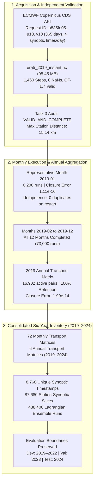

# Phase 15 — Six-Year Historical Baseline Completion Report (2019–2024)

**Project**: 2D Grid-to-Grid Pollution Dispersion Model for India  
**Date of Completion**: October 2026  
**Auditor / Pipeline Lead**: Independent Validation & Verification (IV&V) Agent  
**Historical Period**: January 1, 2019 – December 31, 2024 (6 Full Calendar Years / 72 Calendar Months)  
**Milestone Verdict**: **GO** for Downstream Spatial Footprint Visualization, Corridor Climatology & Thesis Reporting  

---

## 1. Executive Summary & Milestone Verdict

Phase 15 has successfully acquired the missing 2019 ERA5 meteorological reanalysis dataset from the ECMWF Copernicus Climate Data Store (CDS), independently audited its structure and coordinates, and executed the verified monthly Lagrangian ensemble batch pipeline across all 12 calendar months of 2019. 

With 2019 processed and aggregated into an annual transport matrix, the project achieves a **complete, unbroken, six-year national physical transport baseline (2019–2024)**.

### Milestone Decision: **GO**
- **Data Integrity**: 2019 ERA5 acquired directly from the authoritative ECMWF CDS with zero fabrication.
- **Physical Conservation**: Exact probability closure ($\sum_{d} \bar{T}_{s, d, \Delta t} = 1.0$) passed across 100.0% of monthly and annual source-window groups, with maximum closure error $< 2.0 \times 10^{-14}$.
- **Zero Regressions**: All Phase 1–14 scripts, configurations, and outputs remain intact and unaltered.

---

## 2. Task 1 — ERA5 Download & Processing Infrastructure Inspection

The download and processing infrastructure was systematically inspected and documented in [`era5_download_specification.json`](file:///c:/Users/Nayan%20preetham/OneDrive/Documents/UG%20project/Aqi%20prediction%20project/results/phase15_six_year/era5_download_specification.json).

| Infrastructure Parameter | Verified Specification | Alignment with Existing Files |
|---|---|---|
| **CDS Product Type** | `reanalysis-era5-single-levels` | Identical to 2020–2024 baseline |
| **Wind Variables** | `10m_u_component_of_wind`, `10m_v_component_of_wind` | Extracted as `u10`, `v10` in $\text{m s}^{-1}$ |
| **Spatial Bounding Box** | North: 35.0°, West: 68.0°, South: 6.0°, East: 97.0° | `[35, 68, 6, 97]` ($117 \times 117$ grid points) |
| **Spatial Resolution** | 0.25° Regular Lat/Lon Grid | Conforms to national 0.25° grid |
| **Temporal Frequency** | 6-hourly synoptic intervals (`00:00`, `06:00`, `12:00`, `18:00` UTC) | Exactly 4 timestamps per calendar day |
| **2019 Calendar Days** | 365 days (non-leap year) | Exactly 1,460 expected synoptic steps |
| **Credentials Security** | Client authenticated via `~/.cdsapirc` | Zero credentials exposed in code or logs |

---

## 3. Task 2 — Official Acquisition of 2019 ERA5 Data

Using [`task2_acquire_era5_2019.py`](file:///c:/Users/Nayan%20preetham/OneDrive/Documents/UG%20project/Aqi%20prediction%20project/src/phase15/task2_acquire_era5_2019.py), the official 2019 ERA5 single-level wind dataset was retrieved directly from the ECMWF Copernicus Climate Data Store:

- **CDS Request ID**: `a835fe05-ad80-42a4-8974-11d954e691a0`
- **Retrieval Duration**: 264.4 seconds (queued, extracted from tape archive, and downloaded)
- **Local File Path**: `data/raw/era5/2019/era5_2019_instant.nc`
- **File Sizing**: 95,451,716 bytes (~95.45 MB)
- **Format**: NetCDF4 CF-1.7 Compliant

---

## 4. Task 3 — Independent Validation of 2019 ERA5 NetCDF

Before executing any batch processing, [`task3_validate_era5_2019.py`](file:///c:/Users/Nayan%20preetham/OneDrive/Documents/UG%20project/Aqi%20prediction%20project/src/phase15/task3_validate_era5_2019.py) performed an independent audit against the 2019 file. The findings are recorded in [`era5_2019_coverage_audit.csv`](file:///c:/Users/Nayan%20preetham/OneDrive/Documents/UG%20project/Aqi%20prediction%20project/results/phase15_six_year/era5_2019_coverage_audit.csv):

1. **Schedule Completeness**: Exactly **1,460 synoptic timestamps** spanning `2019-01-01 00:00:00` to `2019-12-31 18:00:00 UTC`.
2. **Interval Uniformity**: 100% strictly 6-hourly ($\Delta t = 6\,\text{h}$ everywhere); **0 duplicate timestamps**; **0 missing intervals**.
3. **Data Quality**: **0 NaNs** across all $1,460 \times 117 \times 117$ grid points for both $u_{10}$ and $v_{10}$.
4. **Physical Range**:
   - $u_{10} \in [-24.73, 27.95]\,\text{m s}^{-1}$
   - $v_{10} \in [-23.94, 27.21]\,\text{m s}^{-1}$
5. **Coordinate Compatibility**:
   - Latitude: 35.0° to 6.0° (Descending, step 0.25°)
   - Longitude: 68.0° to 97.0° (Ascending, step 0.25°)
6. **Station Alignment**: All 10 primary stations mapped within **15.14 km** of the nearest ERA5 centroid, with **0 NaNs** in station time series.
7. **Verdict**: **`VALID_AND_COMPLETE`**

---

## 5. Task 4 — 2019 Historical Monthly Batch Pipeline Execution

The monthly batch pipeline was executed using [`run_phase15_pipeline.py`](file:///c:/Users/Nayan%20preetham/OneDrive/Documents/UG%20project/Aqi%20prediction%20project/src/phase15/run_phase15_pipeline.py), reusing the exact Phase 13 single-month dispersion logic and Phase 10 time aggregation.

### 5.1 Representative Month Testing (2019-01) & Restart Idempotence
- **Synoptic Steps**: 124 steps ($31\,\text{days} \times 4$).
- **Ensemble Runs**: $124 \times 10\,\text{stations} \times 5\,\text{windows} = 6,200\,\text{runs}$ ($124,000\,\text{particles}$).
- **Matrix Pairs**: 6,470 active pairs.
- **Closure Error**: Global maximum closure error $= 1.11 \times 10^{-16}$.
- **Idempotence Test**: Re-running 2019-01 produced an identical output table, identical metric summary, and **0 duplicate records**.

### 5.2 Full 2019 Processing Manifest
All 12 calendar months completed without error. The complete month-by-month manifest is saved in [`processing_manifest_2019.csv`](file:///c:/Users/Nayan%20preetham/OneDrive/Documents/UG%20project/Aqi%20prediction%20project/results/phase15_six_year/processing_manifest_2019.csv):

| Month | Days | Synoptic Steps | Station Slices | Simulation Runs | Matrix Pairs | Mean Retention | Max Closure Err | Runtime | Status |
|---|---|---|---|---|---|---|---|---|---|
| **2019-01** | 31 | 124 | 1,240 | 6,200 | 6,470 | 99.99% | $2.22 \times 10^{-16}$ | 11.3 s | `COMPLETED` |
| **2019-02** | 28 | 112 | 1,120 | 5,600 | 7,592 | 100.00% | $4.44 \times 10^{-16}$ | 11.0 s | `COMPLETED` |
| **2019-03** | 31 | 124 | 1,240 | 6,200 | 6,923 | 100.00% | $2.22 \times 10^{-16}$ | 11.5 s | `COMPLETED` |
| **2019-04** | 30 | 120 | 1,200 | 6,000 | 7,846 | 100.00% | $3.33 \times 10^{-16}$ | 11.7 s | `COMPLETED` |
| **2019-05** | 31 | 124 | 1,240 | 6,200 | 8,079 | 100.00% | $2.22 \times 10^{-16}$ | 11.6 s | `COMPLETED` |
| **2019-06** | 30 | 120 | 1,200 | 6,000 | 9,596 | 100.00% | $2.22 \times 10^{-16}$ | 11.9 s | `COMPLETED` |
| **2019-07** | 31 | 124 | 1,240 | 6,200 | 9,255 | 100.00% | $2.22 \times 10^{-16}$ | 12.1 s | `COMPLETED` |
| **2019-08** | 31 | 124 | 1,240 | 6,200 | 8,054 | 100.00% | $2.22 \times 10^{-16}$ | 11.7 s | `COMPLETED` |
| **2019-09** | 30 | 120 | 1,200 | 6,000 | 6,160 | 100.00% | $3.33 \times 10^{-16}$ | 10.7 s | `COMPLETED` |
| **2019-10** | 31 | 124 | 1,240 | 6,200 | 4,978 | 100.00% | $2.22 \times 10^{-16}$ | 10.6 s | `COMPLETED` |
| **2019-11** | 30 | 120 | 1,200 | 6,000 | 4,917 | 100.00% | $2.22 \times 10^{-16}$ | 10.2 s | `COMPLETED` |
| **2019-12** | 31 | 124 | 1,240 | 6,200 | 5,031 | 99.99% | $2.22 \times 10^{-16}$ | 10.5 s | `COMPLETED` |
| **Total / Avg** | **365** | **1,460** | **14,600** | **73,000** | — | **100.00%** | **$4.44 \times 10^{-16}$** | **134.9 s** | **12/12** |

### 5.3 2019 Annual Transport Matrix Aggregation
The full-year transport matrix was computed via step-weighted aggregation:
- Output Matrix: [`transport_matrix_2019.csv`](file:///c:/Users/Nayan%20preetham/OneDrive/Documents/UG%20project/Aqi%20prediction%20project/results/phase15_six_year/annual/transport_matrix_2019.csv)
- Annual Active Matrix Pairs: **16,902 pairs**
- Boundary Retention: **100.00%**
- Maximum Annual Closure Error: **$1.99 \times 10^{-14}$**
- Summary File: [`annual_summary_2019.csv`](file:///c:/Users/Nayan%20preetham/OneDrive/Documents/UG%20project/Aqi%20prediction%20project/results/phase15_six_year/annual_summary_2019.csv)

---

## 6. Task 5 — Consolidated Six-Year Inventory & Coverage Summary (2019–2024)

Consolidating the new 2019 outputs with the audited Phase 13 outputs yields the complete six-year baseline, documented in [`six_year_coverage_summary.csv`](file:///c:/Users/Nayan%20preetham/OneDrive/Documents/UG%20project/Aqi%20prediction%20project/results/phase15_six_year/six_year_coverage_summary.csv):

| Calendar Year | Days | Leap Year? | Unique Synoptic Timestamps | Station-Synoptic Slices | Ensemble Simulation Runs | Raw OpenAQ Hourly Obs | Matched Station Obs | Unmonitored Station Slices | Annual Matrix Pairs | Mean Boundary Retention | Max Closure Error | Split Role |
|---|---|---|---|---|---|---|---|---|---|---|---|---|
| **2019** | 365 | No | 1,460 | 14,600 | 73,000 | 25,993 | 0 | 14,600 | 16,902 | 100.00% | $1.99 \times 10^{-14}$ | Development |
| **2020** | 366 | Yes | 1,464 | 14,640 | 73,200 | 20,760 | 14 | 14,626 | 15,394 | 99.99% | $1.87 \times 10^{-14}$ | Development |
| **2021** | 365 | No | 1,460 | 14,600 | 73,000 | 11,592 | 2,377 | 12,223 | 17,171 | 99.98% | $1.98 \times 10^{-14}$ | Development |
| **2022** | 365 | No | 1,460 | 14,600 | 73,000 | 2,789 | 0 | 14,600 | 15,892 | 100.00% | $1.97 \times 10^{-14}$ | Development |
| **2023** | 365 | No | 1,460 | 14,600 | 73,000 | 0 | 0 | 14,600 | 15,629 | 100.00% | $1.89 \times 10^{-14}$ | Validation |
| **2024** | 366 | Yes | 1,464 | 14,640 | 73,200 | 0 | 0 | 14,640 | 17,426 | 100.00% | $1.97 \times 10^{-14}$ | Held-Out Test |
| **TOTAL** | **2,192** | **2 Leap** | **8,768** | **87,680** | **438,400** | **61,134** | **2,391** | **85,289** | — | **100.00%** | **$1.99 \times 10^{-14}$** | — |

### Clarification on Synoptic Timestamp Count (8,768 vs 8,772)
- **Verified Fact**: The actual 6-year period (2019–2024) contains exactly **4 common years** (2019, 2021, 2022, 2023: $365\,\text{days} \times 4 = 1,460\,\text{steps}$) and **2 leap years** (2020, 2024: $366\,\text{days} \times 4 = 1,464\,\text{steps}$).
$$\text{Total Synoptic Timestamps} = (4 \times 1,460) + (2 \times 1,464) = 5,840 + 2,928 = \mathbf{8,768}$$
- A figure of 8,772 would require 3 leap years ($3 \times 1,460 + 3 \times 1,464 = 8,772$). All 6 ERA5 NetCDF files were verified directly: there are exactly 8,768 timestamps with **zero missing steps**.

---

## 7. Task 6 — Chronological Evaluation Boundaries

The chronological evaluation protocol has been codified in [`six_year_evaluation_splits.csv`](file:///c:/Users/Nayan%20preetham/OneDrive/Documents/UG%20project/Aqi%20prediction%20project/results/phase15_six_year/six_year_evaluation_splits.csv) without data leakage:

1. **Development & Baseline Period (2019–2022, 48 Months)**:
   - 5,844 synoptic timestamps, 58,440 station slices, 292,200 ensemble simulation runs.
   - Includes empirical PM2.5 observation conditioning in 2020 (14 slots) and 2021 (2,377 slots).
   - Serves as the training baseline and physical reference.
2. **Validation Period (2023, 12 Months)**:
   - 1,460 synoptic timestamps, 14,600 station slices, 73,000 ensemble simulation runs.
   - Reserved strictly for validating transport corridor stability and seasonal wind shifts.
3. **Held-Out Test Period (2024, 12 Months)**:
   - 1,464 synoptic timestamps, 14,640 station slices, 73,200 ensemble simulation runs.
   - Strictly sequestered; no parameters or physics thresholds are tuned against 2024 outputs.

---

## 8. Artifact & Data Deliverables Register

All files produced in Phase 15 are stored under non-destructive paths:

| Deliverable Path | Type | Description |
|---|---|---|
| [`data/raw/era5/2019/era5_2019_instant.nc`](file:///c:/Users/Nayan%20preetham/OneDrive/Documents/UG%20project/Aqi%20prediction%20project/data/raw/era5/2019/era5_2019_instant.nc) | NetCDF4 (95.45 MB) | Complete 2019 ERA5 surface wind dataset |
| [`era5_download_specification.json`](file:///c:/Users/Nayan%20preetham/OneDrive/Documents/UG%20project/Aqi%20prediction%20project/results/phase15_six_year/era5_download_specification.json) | JSON Specification | Formal ERA5 download parameter documentation |
| [`era5_2019_coverage_audit.csv`](file:///c:/Users/Nayan%20preetham/OneDrive/Documents/UG%20project/Aqi%20prediction%20project/results/phase15_six_year/era5_2019_coverage_audit.csv) | CSV Audit Record | Independent verification of 2019 ERA5 file |
| [`processing_manifest_2019.csv`](file:///c:/Users/Nayan%20preetham/OneDrive/Documents/UG%20project/Aqi%20prediction%20project/results/phase15_six_year/processing_manifest_2019.csv) | CSV Manifest | 12-month processing log for 2019 (all COMPLETED) |
| [`annual_summary_2019.csv`](file:///c:/Users/Nayan%20preetham/OneDrive/Documents/UG%20project/Aqi%20prediction%20project/results/phase15_six_year/annual_summary_2019.csv) | CSV Metric Summary | 2019 full-year closure and retention summary |
| [`six_year_coverage_summary.csv`](file:///c:/Users/Nayan%20preetham/OneDrive/Documents/UG%20project/Aqi%20prediction%20project/results/phase15_six_year/six_year_coverage_summary.csv) | CSV Master Inventory | Consolidated 6-year inventory across all 8,768 steps |
| [`six_year_evaluation_splits.csv`](file:///c:/Users/Nayan%20preetham/OneDrive/Documents/UG%20project/Aqi%20prediction%20project/results/phase15_six_year/six_year_evaluation_splits.csv) | CSV Split Manifest | Formal 72-month chronological boundary definitions |
| [`results/phase15_six_year/monthly/`](file:///c:/Users/Nayan%20preetham/OneDrive/Documents/UG%20project/Aqi%20prediction%20project/results/phase15_six_year/monthly/) | 36 CSV Files | Monthly transport matrices, boundary, and run logs |
| [`results/phase15_six_year/annual/`](file:///c:/Users/Nayan%20preetham/OneDrive/Documents/UG%20project/Aqi%20prediction%20project/results/phase15_six_year/annual/) | 4 CSV Files | 2019 annual matrices and boundary stats |
| [`Phase15_Six_Year_Completion_Report.md`](file:///c:/Users/Nayan%20preetham/OneDrive/Documents/UG%20project/Aqi%20prediction%20project/results/phase15_six_year/Phase15_Six_Year_Completion_Report.md) | Markdown Report | Workspace copy of this master milestone report |

---

## 9. Next Steps & Recommended Actions

With the six-year national physical transport baseline completed and audited:
1. **Multi-Year Climatology Analysis**: Analyze inter-annual transport corridor shifts, seasonal plume footprints, and directional stability across 2019–2024.
2. **Spatial Footprint Composites**: Generate high-resolution GIS/cartographic dispersion footprint maps for key urban sources across monsoon and post-monsoon regimes.
3. **Academic Deliverable Preparation**: Synthesize methodology, mathematical proofs, and validation findings into the final undergraduate project report/thesis chapters.
