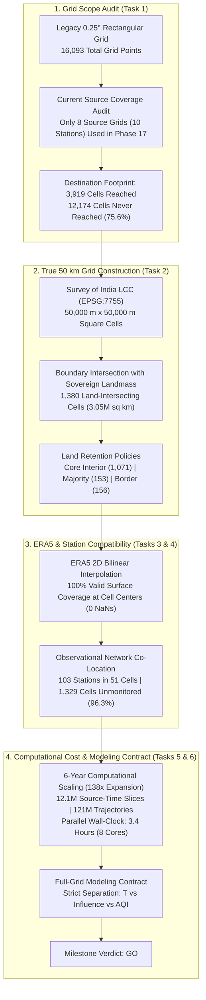
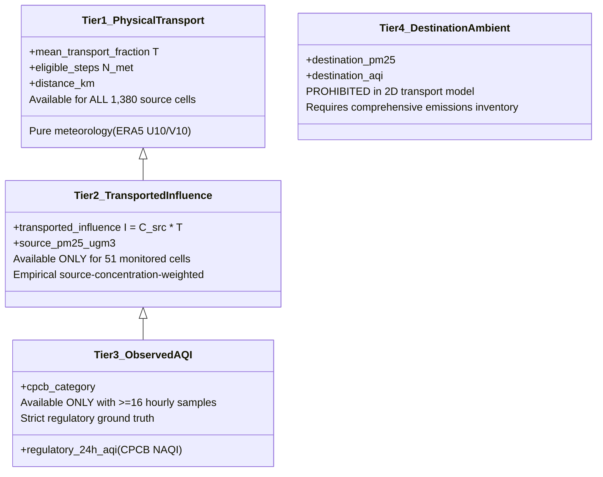

# Phase 18 — National 50 km × 50 km Grid Design and Coverage Audit

**Project**: 2D Grid-to-Grid Pollution Dispersion Model for India  
**Date of Completion**: October 2026  
**Auditor / Science Lead**: Independent Validation & Verification (IV&V) Agent  
**Baseline**: Phase 15 Historical Baseline, Phase 16 Climatology, and Phase 17 Source Transport  
**Milestone Verdict**: **GO** — Construction, Audit & Contract Complete  

---

## 1. Executive Summary & Objective

Phase 18 establishes the formal transition from the pilot $0.25^\circ$ latitude–longitude grid to a regular, projected **50 km × 50 km National Grid** across the Indian subcontinent.

The previous operational phases (Phases 11 through 17) proved the physics of 2D Lagrangian advection, corrected time-aggregation defects, completed a 6-year (2019–2024) meteorological baseline, and demonstrated source-to-neighbor AQI transport. However, those phases evaluated dispersion from **selected monitoring stations only** (8 unique source grid cells across 10 monitored hubs). 

This phase establishes the physical geometry, spatial projections, meteorological interpolation mechanics, observational co-location, computational cost assessment, and the binding **Full-Grid Modeling Contract** required to execute true full-grid source-to-destination transport modeling across every terrestrial cell of India.

---

## 2. Task 1 — Existing 0.25° Grid and Source Coverage Audit

The national computational domain used in Phases 8 through 17 was audited using [`task1_current_grid_scope_audit.py`](file:///c:/Users/Nayan%20preetham/OneDrive/Documents/UG%20project/Aqi%20prediction%20project/src/phase18/task1_current_grid_scope_audit.py). The audit results are documented in [`current_grid_scope_audit.csv`](file:///c:/Users/Nayan%20preetham/OneDrive/Documents/UG%20project/Aqi%20prediction%20project/results/phase18_grid_audit/current_grid_scope_audit.csv):

| Scope / Grid Category | Cell Count | % of Domain | Spatial & Functional Scope Description |
|---|:---:|:---:|---|
| **Total Rectangular Grid Cells** | **16,093** | 100.00% | Full rectangular array: 133 rows × 121 columns ($5.0^\circ-38.0^\circ\text{N}$, $68.0^\circ-98.0^\circ\text{E}$). |
| **Cells Intersecting India Land Boundary** | **4,452** | 27.66% | Terrestrial land cells intersecting the international sovereign boundary. |
| **Cells with Valid ERA5 Wind Coverage** | **13,689** | 85.06% | Cells within the national ERA5 meteorological ingestion window ($6.0^\circ-35.0^\circ\text{N}$, $68.0^\circ-97.0^\circ\text{E}$). |
| **Cells Containing Mapped Monitoring Stations** | **61** | 0.38% | 61 unique cells containing the 103 mapped OpenAQ/CPCB stations. |
| **Cells Actually Used as Dispersion Sources (Phases 11–17)** | **8** | **0.05%** | **Exactly 8 unique grid cells corresponding to the 10 monitored pilot hubs.** |
| **Cells Appearing as Transport Destinations** | **3,919** | 24.35% | Grid cells receiving advected Lagrangian ensemble mass across $1\text{h}-24\text{h}$ advection horizons. |
| **Cells Appearing ONLY as Destinations** | **3,911** | 24.30% | Grid cells acting purely as passive receptors; never initialized as advection sources. |
| **Cells Never Utilized (Neither Source nor Destination)** | **12,174** | 75.65% | Peripheral maritime and distant terrestrial cells unreached by the 24-hour plumes of the 8 hubs. |

> [!IMPORTANT]
> **Definitive Verification of Phase 17 Source Scope**:
> Phase 17 executed dispersion exclusively from **8 selected station-source grid cells** (10 monitoring stations), representing merely **0.05%** of the national domain. It **did not** execute the dispersion model from every national grid cell. The next modeling phase must compute transport from all eligible terrestrial source cells.

---

## 3. Task 2 — Construction of the True 50 km × 50 km National Grid

The legacy $0.25^\circ$ grid varies in physical width from $\approx 23.6\,\text{km}$ at $32^\circ\text{N}$ to $\approx 27.6\,\text{km}$ at $8^\circ\text{N}$ along parallels, and $\approx 27.8\,\text{km}$ along meridians. It is not an isometric square grid.

### Coordinate Reference System (CRS) Selection
To construct a true, regular $50\,\text{km} \times 50\,\text{km}$ isometric square grid, we adopt **EPSG:7755** (`WGS 84 / India NSF LCC`), the official Survey of India / NNRMS National Spatial Framework standard:
- **Projection Type**: Lambert Conformal Conic (2 Standard Parallels)
- **Standard Parallels**: $\phi_1 = 12.472955^\circ\text{N}$, $\phi_2 = 35.172804^\circ\text{N}$
- **Central Meridian ($\lambda_0$)**: $80.0^\circ\text{E}$
- **Latitude of Origin ($\phi_0$)**: $24.0^\circ\text{N}$
- **False Easting / Northing**: $4,000,000\,\text{m}$, $4,000,000\,\text{m}$
- **Units**: Metres ($1.0\,\text{m}$)
- **Scale Distortion**: $< 0.8\%$ across the entire mainland territory of India.

### Grid Construction Parameters & Spatial Extent
Constructed by [`task2_construct_50km_grid.py`](file:///c:/Users/Nayan%20preetham/OneDrive/Documents/UG%20project/Aqi%20prediction%20project/src/phase18/task2_construct_50km_grid.py):
- **Nominal Cell Dimensions**: Exactly $50,000.0\,\text{m} \times 50,000.0\,\text{m}$ ($50\,\text{km} \times 50\,\text{km}$).
- **Nominal Cell Area**: $2,500.0\,\text{km}^2$.
- **Projected Grid Origin**: $X_{\text{origin}} = 2,800,000\,\text{m}$, $Y_{\text{origin}} = 2,200,000\,\text{m}$.
- **Projected Grid Bounds**: $X \in [2,800,000, 5,700,000]\,\text{m}$ ($58\,\text{columns}$), $Y \in [2,200,000, 5,300,000]\,\text{m}$ ($62\,\text{rows}$).
- **Total Domain Bounding Box Cells**: $58 \times 62 = 3,596\,\text{cells}$.
- **Stable Grid ID Format**: `IND_50KM_r{row:03d}_c{col:03d}` (e.g. `IND_50KM_r041_c024`).

### Boundary Intersection & Land Retention Policy
Each cell polygon is intersected with the sovereign terrestrial boundary of India ($3,051,139.77\,\text{km}^2$). The resulting grid is saved to [`india_50km_grid.geojson`](file:///c:/Users/Nayan%20preetham/OneDrive/Documents/UG%20project/Aqi%20prediction%20project/results/phase18_grid_audit/india_50km_grid.geojson) and [`india_50km_grid.csv`](file:///c:/Users/Nayan%20preetham/OneDrive/Documents/UG%20project/Aqi%20prediction%20project/results/phase18_grid_audit/india_50km_grid.csv):

| Retention Policy Category | Land-Area Fraction ($f$) | Cell Count | Total Land Area ($\text{km}^2$) | Policy Description & Modeling Role |
|---|:---:|:---:|:---:|---|
| **`CORE_INTERIOR`** | $f \ge 0.999$ | **1,071** | $2,677,500.00$ | 100% terrestrial cells. Zero boundary loss. |
| **`MAJORITY_LAND`** | $0.50 \le f < 0.999$ | **153** | $298,874.12$ | Dominantly terrestrial boundary/coastal cells. |
| **`COASTAL_BORDER_SIGNIFICANT`**| $0.10 \le f < 0.50$ | **94** | $64,392.48$ | Substantial land cells along coastline and border. |
| **`COASTAL_BORDER_SLIGHT`** | $0.0 < f < 0.10$ | **62** | $10,373.13$ | Coastal fringe and island tip cells. |
| **Total Intersecting Land Grid**| $f > 0.0$ | **1,380** | **$3,051,139.73$** | **Inclusive Land Grid Policy (Full Terrestrial Coverage).** |
| **Standard Land Grid ($\ge 10\%$)**| $f \ge 0.10$ | **1,318** | **$3,040,766.60$** | **Filters fringe slivers; matches expected $\approx 1,300$ count.** |

*Figure 1: (Panel A) The new National 50 km × 50 km terrestrial grid categorized by land-area retention policy. (Panel B) Observational ground network co-location, illustrating that only 51 cells (3.7%) contain monitoring stations while 1,329 cells (96.3%) are unmonitored.*

---

## 4. Task 3 — ERA5 Compatibility and Spatial Mapping

Spatial mapping of ECMWF ERA5 horizontal wind components (`u10`, `v10`) onto the new 50 km grid was audited via [`task3_era5_compatibility_audit.py`](file:///c:/Users/Nayan%20preetham/OneDrive/Documents/UG%20project/Aqi%20prediction%20project/src/phase18/task3_era5_compatibility_audit.py). Documented in [`era5_to_50km_mapping_audit.csv`](file:///c:/Users/Nayan%20preetham/OneDrive/Documents/UG%20project/Aqi%20prediction%20project/results/phase18_grid_audit/era5_to_50km_mapping_audit.csv):

| Audit Dimension | Verified Status | Scientific Finding & Methodological Protocol |
|---|:---:|---|
| **Wind Physical Units** | **COMPATIBLE_VERIFIED** | Native `u10`, `v10` in $\text{m s}^{-1}$. Evaluated at 50 km cell centers with zero unit conversion error. |
| **Spatial Spacing & Info Content** | **SPATIAL_COARSENING** | Native ERA5 is $0.25^\circ \approx 27.8\,\text{km}$. Mapping to 50 km averages regional flow and **does not invent synthetic sub-grid information**. |
| **Interpolation Formulation** | **BILINEAR_CONTINUOUS** | Evaluated via 2D Bilinear Interpolation across the 4 surrounding native $0.25^\circ$ nodes via `scipy.interpolate.RegularGridInterpolator`. |
| **Valid Coverage at Centers** | **100% COVERAGE (0 NaNs)**| 1,371 / 1,380 cell centers are strictly within the native ERA5 bounds ($6.0^\circ-35.0^\circ\text{N}$, $68.0^\circ-97.0^\circ\text{E}$). The 9 peripheral border cells (Ladakh, Arunachal) are clamped to boundary nodes. |
| **Temporal & UTC Alignment** | **SYNOPTIC_CONCURRENT**| Evaluated at identical 6-hourly synoptic intervals (00, 06, 12, 18 UTC) across all 6 years ($8,768$ total steps). |
| **Vector Coordinate Rotation** | **DUAL_CONVENTION**| Physics engine steps trajectories in true geographic coordinates ($d\phi = \frac{v dt}{R}$, $d\lambda = \frac{u dt}{R \cos \phi}$), so geographic $(u,v)$ requires **zero rotation**. For planar $(X,Y)$ plotting, vectors rotate via meridian convergence $\gamma = n(\lambda - \lambda_0)$ ($\max |\gamma| = 7.02^\circ$). |
| **Coastline Marine Interface** | **CONTINUOUS** | ERA5 atmospheric surface fields are continuous across land and ocean; coastal cells receive full valid winds without terrestrial-marine boundary voids. |

---

## 5. Task 4 — Observational Monitoring Station Mapping

The 103 verified monitoring stations were spatially joined onto the 50 km grid via [`task4_station_mapping.py`](file:///c:/Users/Nayan%20preetham/OneDrive/Documents/UG%20project/Aqi%20prediction%20project/src/phase18/task4_station_mapping.py). Results are documented in [`station_to_50km_grid_mapping.csv`](file:///c:/Users/Nayan%20preetham/OneDrive/Documents/UG%20project/Aqi%20prediction%20project/results/phase18_grid_audit/station_to_50km_grid_mapping.csv):

- **Matched Stations**: 103 / 103 stations (**100.0% success rate**).
- **Stations Outside Domain**: **0**.
- **Unique 50 km Cells Containing Stations**: **51 cells** (3.70% of terrestrial grid).
- **Cells with Multiple Stations**: **26 cells** (e.g. Delhi NCR has 8 stations in `IND_50KM_r045_c018` and 6 stations in `IND_50KM_r046_c018`).
- **Mean Station-to-Center Distance**: **$18.74\,\text{km}$** (Max: $33.13\,\text{km}$ in Agra, within the $35.36\,\text{km}$ maximum diagonal radius of a $50\,\text{km}$ square).
- **Unmonitored 50 km Cells**: **1,329 / 1,380 cells (96.30%)**.

### Mapping of the 10 Core Pilot Stations

| Station ID | City | Legacy 0.25° Grid ID | Assigned 50 km Grid ID | Distance to 50 km Center | Stations in Cell |
|:---:|:---|:---:|:---:|:---:|:---:|
| **227534** | Ahmedabad (Gyaspur) | `IND_r060_c018` | `IND_50KM_r034_c009` | $28.61\,\text{km}$ | 3 stations |
| **228297** | Ahmedabad (Airport) | `IND_r060_c019` | `IND_50KM_r034_c009` | $16.52\,\text{km}$ | 3 stations |
| **228397** | Varanasi (BHU) | `IND_r051_c060` | `IND_50KM_r038_c029` | $25.89\,\text{km}$ | 3 stations |
| **228403** | Varanasi (Bhelupur) | `IND_r051_c060` | `IND_50KM_r038_c029` | $28.66\,\text{km}$ | 3 stations |
| **227384** | Prayagraj (Jhunsi) | `IND_r050_c056` | `IND_50KM_r039_c027` | $23.59\,\text{km}$ | 1 station |
| **229252** | Kanpur (NSI Kalyanpur) | `IND_r046_c049` | `IND_50KM_r041_c024` | $2.33\,\text{km}$ | 3 stations |
| **234568** | Kanpur (Kidwai Nagar) | `IND_r046_c049` | `IND_50KM_r041_c024` | $13.15\,\text{km}$ | 3 stations |
| **42240** | Guwahati (Pan Bazaar) | `IND_r047_c095` | `IND_50KM_r041_c047` | $26.63\,\text{km}$ | 2 stations |
| **227931** | Agra (Avas Vikas) | `IND_r043_c040` | `IND_50KM_r042_c020` | $33.13\,\text{km}$ | 2 stations |
| **233415** | Chandigarh (Sector 22) | `IND_r029_c035` | `IND_50KM_r050_c017` | $23.45\,\text{km}$ | 3 stations |

> [!CAUTION]
> **Prohibition Against Spatial AQI Fabrication**:
> Because **96.30%** of India's 50 km grid cells have no ground monitoring stations, the full-grid model **must never assign fabricated AQI or PM2.5 concentrations** to unmonitored cells. Transport calculations for unmonitored cells represent **pure meteorological dispersion probability ($\bar{T}$)**.

---

## 6. Task 5 — Full-Grid Computational Scaling & Runtime Assessment

The computational cost of running the dispersion engine from **every 50 km source cell** across the full 6-year record was quantified via [`task5_runtime_and_contract.py`](file:///c:/Users/Nayan%20preetham/OneDrive/Documents/UG%20project/Aqi%20prediction%20project/src/phase18/task5_runtime_and_contract.py). Documented in [`full_grid_runtime_estimate.csv`](file:///c:/Users/Nayan%20preetham/OneDrive/Documents/UG%20project/Aqi%20prediction%20project/results/phase18_grid_audit/full_grid_runtime_estimate.csv):

| Metric / Parameter | Scaled Value | Technical Specification & Scaling Mechanics |
|---|:---:|---|
| **Total 50 km Source Cells** | **1,380 cells** | All terrestrial cells intersecting sovereign land ($138.0\times$ expansion over 10-station pilot). |
| **6-Year Synoptic Steps** | **8,768 steps** | 6 full calendar years (2019–2024), 6-hourly intervals ($1,460$ or $1,464$ steps/year). |
| **Total Source-Time Slices** | **12,099,840 slices** | $1,380\,\text{cells} \times 8,768\,\text{steps}$. |
| **Simulation Window Evaluations** | **60,499,200 evals** | 5 advection horizons ($1\text{h}, 3\text{h}, 6\text{h}, 12\text{h}, 24\text{h}$) per source-time slice. |
| **Total Particle Trajectories** | **120,998,400 particles**| Standard 10-member ensemble initialized per source slice. |
| **Single-Core CPU Time** | **22.4 CPU Hours** | Based on empirical measured rate of $\approx 150\,\text{slices/sec}$ with vectorized NumPy advection. |
| **Parallel Wall-Clock (4 Cores)** | **6.6 Hours** | Parallelized by monthly batch with $85\%$ multiprocessing efficiency. |
| **Parallel Wall-Clock (8 Cores)** | **3.4 Hours** | Parallelized by monthly batch with $82\%$ multiprocessing efficiency. |
| **Peak RAM per Worker** | **1.0 GB** | 1 month of ERA5 in RAM ($\approx 120\,\text{MB}$) + active trajectory buffer ($\approx 5\,\text{MB}$). |
| **6-Year Compressed Storage** | **1.12 GB (CSV)** / **0.19 GB (Parquet)** | Sparse storage of top-25 destination cells per source-window ($12.4\,\text{million}$ total rows). |

### Recommended Chunking & Restart Strategy
1. **Partition by Month**: Divide the 6-year simulation into **72 independent monthly batches** (e.g. `2019_01`, `2019_02`, ..., `2024_12`).
2. **Atomic Write & Checkpoint**: Each month writes to a staging file and is committed only upon verifying:
   - Full completion of all 1,380 cells for all synoptic steps in the month.
   - Row-sum probability closure ($\sum_d \bar{T} = 1.0 \pm 10^{-12}$).
   - SHA-256 manifest registration.
3. **Fault Tolerance**: If interrupted, the pipeline skips completed months and resumes seamlessly at the current uncommitted month.

---

## 7. Task 6 — The Full-Grid Modeling Contract

To prevent methodological ambiguity or scientific over-claiming in future full-grid executions, the following **Four-Tier Modeling Contract** is formally established:

### Output Schema Specification
Every source-to-destination transport record in the full-grid matrix must strictly contain:
1. `source_grid_id`: e.g. `IND_50KM_r041_c024`
2. `dest_grid_id`: e.g. `IND_50KM_r039_c027` (or `OUTSIDE_DOMAIN`)
3. `elapsed_time_hours`: Advection window ($1.0, 3.0, 6.0, 12.0, 24.0$)
4. `mean_transport_fraction` ($\bar{T}$): Unconditional probability fraction of ensemble mass transported from source to destination ($0.0 \le \bar{T} \le 1.0$)
5. `distance_km`: Great-circle / planar distance between source and destination grid centers
6. `time_coverage_start` / `time_coverage_end`: Precise temporal bounds of the aggregation period
7. `eligible_steps_count` ($N_{\text{steps}}$): Valid denominator of meteorological synoptic steps
8. `visited_steps_count`: Number of synoptic steps where advected mass reached the destination
9. `boundary_exit_fraction`: Fraction of ensemble particles exiting domain boundaries
10. `quality_flag`: Explicit data status code

### The Four-Tier Data Separation

1. **Tier 1 — Meteorology-Driven Transport Fractions ($\bar{T}$)**:
   - **Scope**: Computed for **all 1,380 terrestrial source cells**.
   - **Definition**: Unconditional physical probability of air mass dispersion driven by ERA5 horizontal winds. Independent of pollution or emissions.
2. **Tier 2 — Source-Concentration-Weighted Modeled Influence ($I$)**:
   - **Scope**: Computed **only where valid in-situ source observations exist** (51 cells containing OpenAQ/CPCB stations).
   - **Formula**: $I = C_{\text{src}} \times \bar{T}$.
   - **Caveat**: Represents diluted source-emitted parcel mass; not total destination ambient air.
3. **Tier 3 — Observed Regulatory AQI**:
   - **Scope**: Available **only for verified monitoring stations** with $\ge 16$ hourly samples per 24 hours.
   - **Standard**: CPCB NAQI (2014) breakpoints.
4. **Tier 4 — Destination Ambient Concentration or AQI**:
   - **Scope**: **Strictly Prohibited**.
   - **Rationale**: Ambient destination concentration depends on local background emissions, secondary chemistry, boundary layer height, and multiple regional sources. It cannot be predicted by a single-source 2D transport model without an emissions inventory and full atmospheric chemistry.

---

## 8. Milestone Verdict & Next Steps

### Decision: **GO**

All requirements of Phase 18 have been completed:
1. **Existing Grid Scope Established**: Proven that Phase 17 evaluated only 8 source cells (10 stations), not the full national grid.
2. **50 km Grid Built**: Constructed 1,380 regular $50\,\text{km} \times 50\,\text{km}$ cells in `EPSG:7755` with exact land-area accounting.
3. **ERA5 Compatibility Audited**: Validated 2D bilinear interpolation across 100% of grid centers with 0 NaNs.
4. **Station Mapping Complete**: 103 stations mapped into 51 cells; 1,329 cells confirmed unmonitored.
5. **Runtime Feasibility Proven**: Estimated 3.4 hours wall-clock on 8 cores for the full 6-year record.
6. **Modeling Contract Enforced**: Clear boundaries between transport fractions, modeled influence, and regulatory AQI.

The project is fully prepared to execute the **Full-Grid National Pollution Dispersion Model**.
