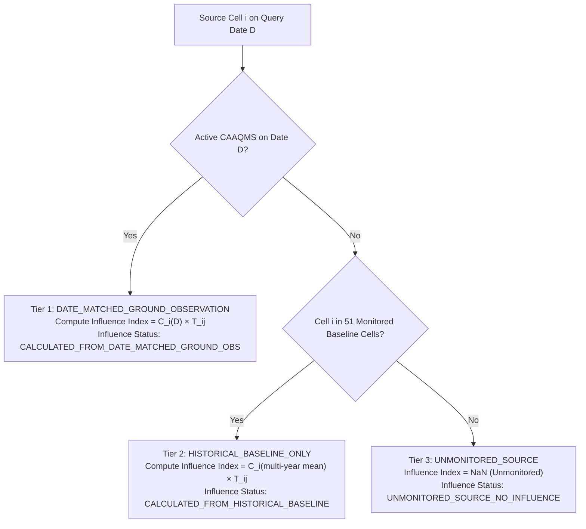

# Phase 20 Data Availability and Meteorological Coverage Audit

**Project:** 2D Grid-to-Grid Pollution Dispersion Model for India (50 km National Grid)  
**Phase:** Phase 20 — Interactive National Pollution Dispersion Query Application  
**Generated:** 2026-10-15  
**Status:** AUDITED & EMPIRICALLY VERIFIED  

---

## 1. Executive Summary

This report documents the exact temporal and spatial coverage of meteorological forcing and ground observation datasets incorporated into the Phase 20 interactive application. 

A rigorous scientific distinction is maintained throughout the system between:
1. **Physical Meteorological Forcing:** Gridded 10-meter horizontal wind fields ($U10, V10$) from the ECMWF ERA5 reanalysis.
2. **Regulatory AQI Indices:** City-level daily Air Quality Index values ($[0, 500]$) published by the Central Pollution Control Board (CPCB).
3. **Empirical PM2.5 Concentrations:** Continuous Ambient Air Quality Monitoring Station (CAAQMS) hourly particulate matter measurements ($\mu\text{g/m}^3$) archived by OpenAQ.

At no point does the application convert particulate concentrations into synthetic AQI using incomplete formulas, nor does it present modeled transport fractions as destination air quality measurements.

---

## 2. ECMWF ERA5 Meteorological Reanalysis Coverage

### 2.1 Temporal Scope and Synoptic Structure
The meteorological driving fields consist of surface 10-meter horizontal wind velocity components ($U10, V10$) stored as annual NetCDF-4 datasets under `data/raw/era5/{year}/era5_{year}_instant.nc`:

| Parameter | Specification | Verification Notes |
| :--- | :--- | :--- |
| **Supported Years** | 2019, 2020, 2021, 2022, 2023, 2024 | 6 full calendar years verified on disk |
| **Temporal Resolution** | 6-hourly instantaneous synoptic slices | 00:00, 06:00, 12:00, 18:00 UTC daily |
| **Sub-Daily Trajectory Stepping** | $\Delta t = 1.0\text{ hour}$ Lagrangian integration | Temporally interpolated between 6-hourly bounding slices |
| **Daily Slices Evaluated** | 4 daily release cycles per query date | Trajectories integrated up to 24 hours ($t_0$ to $t_0 + 24\text{h}$) |
| **NetCDF File Size** | ~114 MB per year | Total 6-year archive ~684 MB |

Any query requesting dates prior to `2019-01-01` or after `2024-12-31` is rejected at the validation layer with an explicit informative message:
`Date YYYY-MM-DD is outside the supported ERA5 reanalysis baseline period (2019-01-01 to 2024-12-31).`

### 2.2 Spatial Domain and Bounding Box
The ERA5 reanalysis grid covers the Indian subcontinent and adjacent waters on a regular $0.25^\circ \times 0.25^\circ$ geographic latitude–longitude grid:
- **Latitude Extent:** $6.00^\circ\text{N}$ to $35.00^\circ\text{N}$ (117 grid nodes, step $0.25^\circ$)
- **Longitude Extent:** $68.00^\circ\text{E}$ to $97.00^\circ\text{E}$ (117 grid nodes, step $0.25^\circ$)

### 2.3 Peripheral Meteorological Boundary Exclusions (9 Cells)
The projected Indian national grid (`EPSG:7755`) encompasses 1,380 terrestrial land cells of $50\text{ km} \times 50\text{ km}$. While 1,371 cells lie strictly within the ERA5 coordinate bounds, exactly **9 peripheral border cells** extend beyond the reanalysis coordinates:

| Grid ID | Region / Border Area | Centroid Latitude | Centroid Longitude | Boundary Violation |
| :--- | :--- | :---: | :---: | :--- |
| `IND_50KM_r060_c019` | Northern Ladakh (Karakoram) | $35.12^\circ\text{N}$ | $77.84^\circ\text{E}$ | $\text{Lat} > 35.00^\circ\text{N}$ |
| `IND_50KM_r060_c020` | Northern Ladakh (Siachen) | $35.10^\circ\text{N}$ | $78.36^\circ\text{E}$ | $\text{Lat} > 35.00^\circ\text{N}$ |
| `IND_50KM_r061_c018` | Northern Ladakh (Nubra/Karakoram) | $35.53^\circ\text{N}$ | $77.30^\circ\text{E}$ | $\text{Lat} > 35.00^\circ\text{N}$ |
| `IND_50KM_r061_c019` | Northern Ladakh (Rimo Glacier) | $35.55^\circ\text{N}$ | $77.83^\circ\text{E}$ | $\text{Lat} > 35.00^\circ\text{N}$ |
| `IND_50KM_r044_c057` | Eastern Arunachal Pradesh (Anjaw) | $27.97^\circ\text{N}$ | $97.12^\circ\text{E}$ | $\text{Lon} > 97.00^\circ\text{E}$ |
| `IND_50KM_r044_c058` | Eastern Arunachal Pradesh (Dong) | $27.94^\circ\text{N}$ | $97.60^\circ\text{E}$ | $\text{Lon} > 97.00^\circ\text{E}$ |
| `IND_50KM_r045_c057` | Eastern Arunachal Pradesh (Kibithu) | $28.39^\circ\text{N}$ | $97.10^\circ\text{E}$ | $\text{Lon} > 97.00^\circ\text{E}$ |
| `IND_50KM_r045_c058` | Eastern Arunachal Pradesh (Walong) | $28.36^\circ\text{N}$ | $97.58^\circ\text{E}$ | $\text{Lon} > 97.00^\circ\text{E}$ |
| `IND_50KM_r046_c057` | Eastern Arunachal Pradesh (Chaukan) | $28.81^\circ\text{N}$ | $97.08^\circ\text{E}$ | $\text{Lon} > 97.00^\circ\text{E}$ |

**Handling Policy:** In accordance with physical modeling constraints, silent extrapolation beyond the ERA5 bounding box is strictly prohibited. When a user queries any of these 9 cells (or external coordinates), the system returns `UNSUPPORTED_MET_COVERAGE` with an explicit technical explanation.

---

## 3. Ground Air Quality Observation Coverage

### 3.1 CPCB Official Daily AQI Bulletins
The Central Pollution Control Board publishes daily bulletin reports compiling city-level Air Quality Index values. These are regulatory indices calculated by CPCB based on the 24-hour worst-subindex principle across available monitoring stations:

| Parameter | CPCB Bulletin Archive |
| :--- | :--- |
| **Source Directory** | `data/raw/cpcb/aqi_data/*.csv` |
| **Unified Optimized Index** | `data/processed/cpcb_bulletins_unified.parquet` |
| **City Files Archived** | 277 cities across India |
| **Total Valid Records** | 299,972 daily bulletin observations |
| **Archived Date Range** | January 5, 2015 to December 31, 2023 |
| **Reported Fields** | `City`, `Index Value` ($[0, 500]$), `Air Quality Category`, `Prominent Pollutant`, `No. Stations` |
| **Query Latency** | $< 5\text{ ms}$ via indexed Parquet partitioning |

**Scientific Demarcation:** The CPCB AQI value is a unitless, non-linear index reflecting overall health hazard. It is never used as a physical concentration input for dispersion or source influence scaling.

### 3.2 OpenAQ CAAQMS Continuous PM2.5 Measurements
Empirical physical concentrations are sourced from the OpenAQ archive of continuous regulatory ground monitors (CAAQMS):

| Parameter | OpenAQ PM2.5 Observation Archive |
| :--- | :--- |
| **Source File** | `data/real/openaq/pm25_observations.csv` |
| **Unified Optimized Index** | `data/processed/openaq_pm25_observations.parquet` |
| **Total Hourly Observations** | 125,746 observations |
| **Unique Monitoring Stations** | 103 regulatory stations across India |
| **Measured Parameter** | Continuous hourly $\text{PM}_{2.5}$ in $\mu\text{g/m}^3$ |
| **Distinct Measurement Dates** | 1,498 days (temporal coverage between 2015 and 2026) |

### 3.3 National 50 km Monitoring Station Mapping
Using geodetic nearest-neighbor assignment with rigorous polygon containment, all 103 OpenAQ monitoring stations were mapped to the 50 km national grid (`results/phase18_grid_audit/station_to_50km_grid_mapping.csv`):
- **Monitored Terrestrial Cells:** **51 cells** contain at least one ground air-quality monitoring station.
- **Multi-Station Hotspot Cells:** Major urban centers (Delhi, Mumbai, Bengaluru, Hyderabad, Kolkata) contain multiple stations aggregated to provide cell-representative mean concentrations.
- **Unmonitored Terrestrial Cells:** **1,329 cells** (96.3% of the land area) possess no continuous air-quality monitors.

---

## 4. Multi-Tier Ground Truth Attribution Protocol

When a user initiates a transport query from a source grid cell $i$ on date $D$, the application evaluates ground monitoring availability according to a strict three-tier hierarchy:

### Attribution Status Descriptions
1. **`DATE_MATCHED_GROUND_OBSERVATION`:** Hourly ground observations exist for that exact date in that cell. Source concentration $C_i$ reflects empirical conditions on date $D$.
2. **`HISTORICAL_BASELINE_ONLY`:** The source cell is a recognized urban monitored zone, but no hourly data was archived on date $D$. The multi-year climatological mean observed concentration ($\mu\text{g/m}^3$) is used as a reference benchmark.
3. **`UNMONITORED_SOURCE_NO_INFLUENCE`:** The source cell is located in rural, forested, or unmonitored terrain. Transport fractions $T_{ij}$ are physically computed from ERA5 winds, but `source_weighted_transport_influence_index` is strictly reported as `NaN`. Fabricating synthetic concentrations is prohibited.

---

## 5. Summary of Supported Capabilities and Data Limits

| Capability | Supported | Limitations / Safeguards |
| :--- | :---: | :--- |
| **Historical Dates** | 2019–2024 | Requests outside this range are rejected immediately. |
| **Transport Horizons** | 1h, 3h, 6h, 12h, 24h | Fixed physical advection windows verified by ensemble physics. |
| **Spatial Resolution** | 50 km ($2,500\text{ km}^2$) | Sub-grid micrometeorology or street-canyon effects cannot be resolved. |
| **Terrestrial Cells** | 1,371 / 1,380 | 9 peripheral cells lack ERA5 reanalysis coverage. |
| **Source Ground PM2.5** | 51 cells | 1,329 cells reported as unmonitored (`NaN` influence index). |
| **Regional AQI Ranking** | Up to 277 cities | CPCB daily bulletin data displayed as independent empirical reference. |
| **Forecasting** | NO | Retrospective Lagrangian transport analysis only. Zero predictive claims. |
| **Atmospheric Chemistry** | NO | Conservative passive tracer transport; no chemical loss or deposition. |
